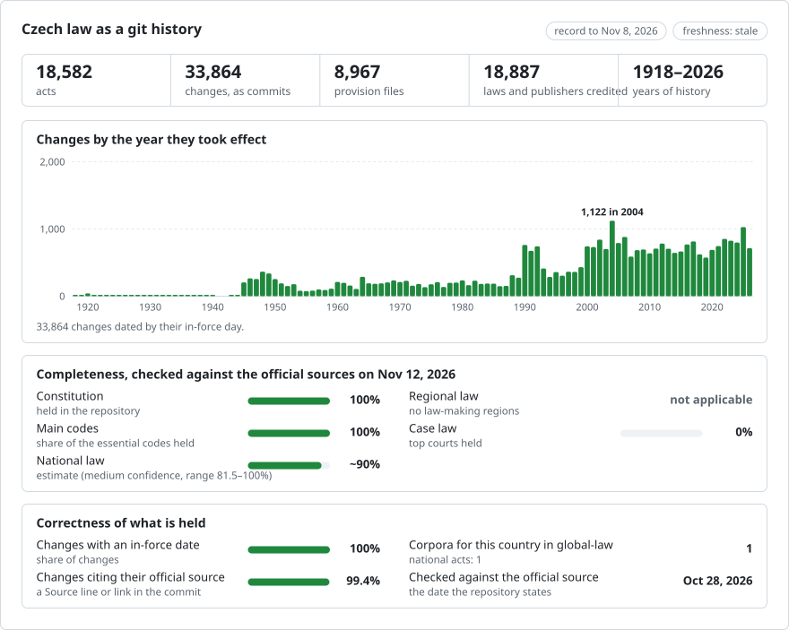

# Czechia: law history in git

**English** · **[Nebo čtěte česky](README.md)**

<picture>
<source media="(prefers-color-scheme: dark)" srcset="data/effort-dark.svg">

</picture>

The law of Czechia as a git history: one file per act, one commit per version on the day it took effect, and the act that made each change as the commit's author. `git blame` names the act behind every line; `git log` lists every change to an act; picking a date gives the text in force that day.

Part of [lexifina/global-law](https://github.com/lexifina/global-law), one git history for every country's law: this is Czechia's national law, which global-law reads at `czechia/national/acts/`.

**What is in it now:** the Constitution, the Charter and 20,924 acts and items of the Sbírka zákonů, 18,583 of them with every consolidated version e-Sbírka publishes; 35,637 local ordinances from 6,182 municipalities and regions; 6,804 items of the Úřední list (1945-1961); 2,263 treaties of the Sbírka mezinárodních smluv; 9,819 EU acts in Czech; 5,633 bills and government drafts, labelled as not law; and 1,188 measures, guidance and agreements of regulators and ministries. [`PLAN.md`](PLAN.md) lists every part this repository is meant to hold and how far each one is.

Each act is one file at its ELI path, `sb/<year>/<number>.md` (`sb/2006/262.md` is the Zákoník práce, the Labour Code, 262/2006 Sb.); the Constitution is [`sb/1993/1.md`](sb/1993/1.md) and the Charter of Fundamental Rights and Freedoms [`sb/1993/2.md`](sb/1993/2.md).

The text is in Czech, as e-Sbírka publishes it. An English translation is not part of this record.

## Questions as git commands

| Question | Command |
| --- | --- |
| Every change to the Labour Code | `git log -p --word-diff -- sb/2006/262.md` |
| Which act wrote each line of the Labour Code? | `git blame sb/2006/262.md` |
| Every version of the Labour Code, with the day each took effect | `git log --format="%h %(trailers:key=In-force,valueonly,separator=) %an" -- sb/2006/262.md` |
| The Labour Code as in force on 1 January 2015 | `python tools/czlaw.py on 2015-01-01 sb/2006/262.md` |

**Outside git**, we also host this record publicly, for free:

- **[Ask Claude about Czech law](https://global-law.lexifina.com/v1/try_claude?country=czechia)**: opens Claude with a first question ready.
- **[Ask ChatGPT](https://global-law.lexifina.com/v1/try_chatgpt?country=czechia)**: the same question in ChatGPT.
- **[Search Czech law on our site](https://lexifina.com/law?country=czechia&q=dovolen%C3%A1)**: a search for "dovolená", with each provision's text and its versions, no account needed.
- **[Developer REST API](https://global-law.lexifina.com/v1/search_law?query=dovolen%C3%A1&jurisdiction=czechia)**: the same search as JSON, with no key. See the [documentation here](https://lexifina.com/api/global-law).

Both assistants read the record through the free Global law connector (MCP, `https://global-law.lexifina.com/mcp`); the first time, the chat gives you the link that adds it. Ask in Czech or in English.

**Host it yourself easily.** All it takes is git and Python, and the tools run on your machine:

```sh
git clone --depth 1 https://github.com/lexifina/global-law && cd global-law
python3 tools/countries.py add czechia/national/acts
python3 tools/law.py show 2026-01-01 czechia/national/acts/sb/2006/262.md
```

Opened in Claude Code, Cursor, VS Code or Codex, the clone also starts a local MCP server with the same tools ([MCP.md](https://github.com/lexifina/global-law/blob/main/MCP.md)).

## Dates

Each commit is dated at noon, Europe/Prague, on the day the version took effect, and carries it in its `In-force:` trailer:

- for every consolidated version, the day e-Sbírka gives it (`znění-datum-účinnosti-od`);
- where e-Sbírka publishes a version before all of it applies, each fragment not yet in force ends in `*(účinnost od YYYY-MM-DD)*` until that day;
- git cannot store dates before 1970, so the 4,889 earlier commits are dated from 1970-01-01, one second apart, with the real day in `In-force:`. Ask for a date with `tools/czlaw.py`, not `git log --before`.

Each change is credited to the act that made it, as e-Sbírka names it (`Zákon č. 71/2012 Sb.`), through e-Sbírka's consolidation links; where they do not say which act, it is credited to `e-Sbírka` (2,682 of 36,217 changes). Corrections e-Sbírka later makes to a published version are appended as their own commits (`Kind: correction`), and the `future` branch holds the versions that were due to take effect after 2026-10-28.

## How it is checked

- `tools/build/check_repo.py` renders every consolidated version again from e-Sbírka's datasets and compares it, byte for byte, with the file in git on the day it took effect; repealed acts must be gone from their end day.
- The letters and digits of every version equal those of e-Sbírka's own fragment texts, whatever the Markdown layout.
- `tools/test_repo.py` checks that blame, the dated tool and the commands above work. The results, and a rebuild that gave the same hashes, are in [`REPRODUCE.md`](REPRODUCE.md).
- History is append-only: `main` only grows, and no published commit is rewritten.
- [vulnerabilities/](vulnerabilities/README.en.md): possible drafting mistakes in Czech law, found by global-law's detectors and checked by hand.

## What it does not show

- **Case law.** None yet: 105,034 Constitutional Court decisions, 165,523 of the Supreme Court and 84,449 of the Supreme Administrative Court, and about 700,000 of the lower courts, are planned (see `PLAN.md`).
- **Most law before 1945.** Of about 6,340 numbered acts of 1918-1938, 593 are here; 1939-1945 and the Austrian and Hungarian law received in 1918 are not.
- **Versions e-Sbírka does not consolidate.** Items it publishes only as promulgated have one text, and versions it marks as never in force are left out.
- **Which act made some changes.** 2,682 changes are still credited to `e-Sbírka`; [data/credits/](data/credits/) names the act for most of the rest that e-Sbírka's links leave open.
- **Stable fragment identifiers.** e-Sbírka may change them until 15 January 2027; the text does not depend on them.

## Sources

| Source | Kind | Past versions | Notes |
| --- | --- | --- | --- |
| [e-Sbírka](https://www.e-sbirka.cz) (Ministerstvo vnitra) | Official collection: Sbírka zákonů, Sbírka mezinárodních smluv, Úřední list | yes, every consolidated version | Open datasets; the legally binding text is the one promulgated in the Collection |
| [Sbírka právních předpisů územních samosprávných celků](https://sbirkapp.gov.cz) | Local ordinances | as published | Ordinances of municipalities and regions |
| [EUR-Lex](https://eur-lex.europa.eu) | EU law in Czech | as published | The Czech text of the Official Journal |
| [psp.cz](https://www.psp.cz), [senat.cz](https://www.senat.cz), the Government's ODok | Bills, votes, government drafts | as published | Labelled as not law |
| ČNB, portal.gov.cz, MPSV | Regulators' measures, ministry bulletins, collective agreements | as published | Each as its publisher issues it |

## Licence

See [`LICENSE`](LICENSE). e-Sbírka's open datasets contain no works protected by copyright, are not a protected database and carry no sui generis database right (their terms of use in the National Open Data Catalogue, data.gov.cz, matched to CC0). The history, commit messages and tools are CC0 1.0.

No AI model wrote or changed legal text; the scripts were written by an AI model (see [`REPRODUCE.md`](REPRODUCE.md)).

## How current it is

- [monitoring/](monitoring/README.en.md): every read of e-Sbírka and the other sources, when, and what came of it (acts added, changed and removed); month by month in [monitoring/checks/](monitoring/checks/), for programs in [data/checks/](data/checks/)
- [WATCHING.en.md](WATCHING.en.md): every official source, what is read on it, how often and when it was last read
- [FRESHNESS.en.md](FRESHNESS.en.md): when the history was last compared with e-Sbírka, and which acts are not here yet and why

## Visualisations

[visualisations/](visualisations/): Czech law in 20 charts, drawn from this repository.

Including:

- Who proposes laws, what the Senate and the President do with them, and how the Chamber votes
- What the Collection of Laws holds, how often it changes and when acts end
- Treaty partners, municipal ordinances, the minimum wage and default interest

## More

From [lexifina/global-law](https://github.com/lexifina/global-law):

- [FEATURES.md](https://github.com/lexifina/global-law/blob/main/FEATURES.md): every feature, and what every corpus must support (`git blame`, `law.py`, the MCP tools)
- [FAQ.md](https://github.com/lexifina/global-law/blob/main/FAQ.md): questions and answers · [CONTRIBUTING.md](https://github.com/lexifina/global-law/blob/main/CONTRIBUTING.md): proposing changes · [MCP.md](https://github.com/lexifina/global-law/blob/main/MCP.md): the MCP server · [REPRODUCE.md](https://github.com/lexifina/global-law/blob/main/REPRODUCE.md): how it was built · [CHANGELOG.md](https://github.com/lexifina/global-law/blob/main/CHANGELOG.md)
- [FRESHNESS.md](https://github.com/lexifina/global-law/blob/main/FRESHNESS.md): how current each corpus is · [Monitoring](https://github.com/lexifina/global-law/tree/main/monitoring): whether updates are running · [WATCHING.md](https://github.com/lexifina/global-law/blob/main/WATCHING.md): how each official source is watched for changes
- [performance/](https://github.com/lexifina/global-law/tree/main/performance): how fast the tools are, measured
- [visualisations/](https://github.com/lexifina/global-law/tree/main/visualisations): charts and bridges across the world's law
- [Vulnerabilities](https://github.com/lexifina/global-law/tree/main/vulnerabilities): mistakes in legislation as published
