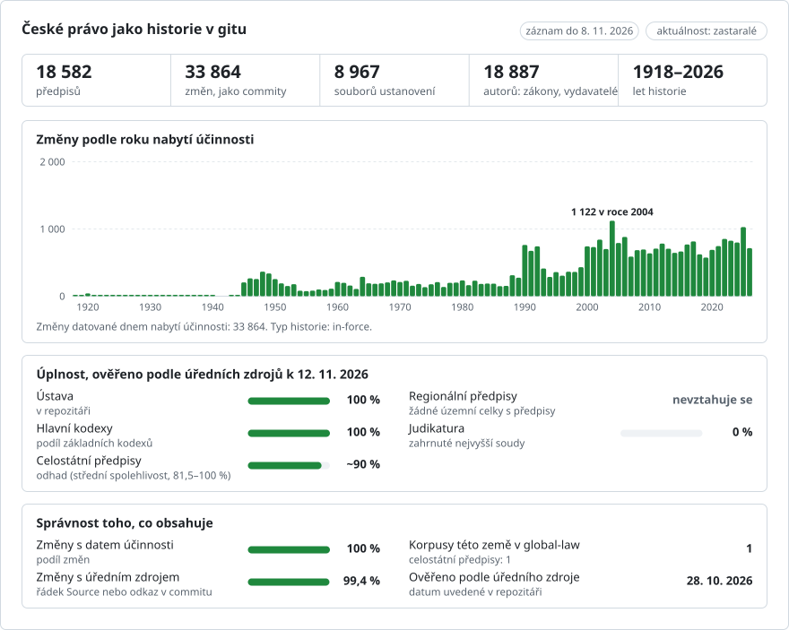

# České právo, změna po změně

**Čeština** · [English](README.en.md)

<picture>
<source media="(prefers-color-scheme: dark)" srcset="data/cs/effort-dark.svg">

</picture>

Součást projektu [lexifina/global-law](https://github.com/lexifina/global-law), jedné historie git pro právo všech zemí: toto je vnitrostátní právo Česka, které global-law čte v `czechia/national/acts/`.

Všechny právní předpisy české **Sbírky zákonů**, které e-Sbírka publikuje v konsolidovaných zněních, jako jeden
repozitář git: 18 576 předpisů (5 114 zákonů, 122 ústavních zákonů, 3 875 nařízení, 9 211 vyhlášek, 100 dekretů,
154 zákonných opatření Senátu a Listina základních práv a svobod). Každý novelizující předpis tvoří jeden commit za
každý den, kdy nabyl účinnosti, připsaný tomuto předpisu a datovaný tímto dnem v poledne pražského času. Text je text
samotné e-Sbírky, z jejích otevřených datových sad ze dne 2026-10-28, doplněný o předpisy, které od té doby nabyly
účinnosti, a o opravy dřívějších znění, které provedla sama e-Sbírka, připojené z jejích datových sad ze dnů 2026-11-02
a 2026-11-08 (viz REPRODUCE.md).

Ústava, 1/1993 Sb., je [`sb/1993/1.md`](sb/1993/1.md); Listina, 2/1993 Sb., je
[`sb/1993/2.md`](sb/1993/2.md).

## Co tu zatím není

Podle úředních počtů ke dni 2026-11-13 je zveřejněno **52,3 %** toho, co potřebuje český právník nebo občan; [PLAN.md](PLAN.md) uvádí každou část a stav její přípravy. Vedle předpisů Sbírky zákonů se všemi konsolidovanými zněními nyní tento repozitář obsahuje položky, které e-Sbírka publikuje jen ve vyhlášeném znění, Úřední list 1945-1961 s jeho historií (`ul/`), Sbírku mezinárodních smluv (`sbms/`), právo EU v češtině (`eu/`, doplňuje se), návrhy zákonů, hlasování a vládní návrhy (`navrhy/`, označené jako texty, které nejsou právem), opatření ČNB (`regulator/`) a praktické tabulky (`data/tables/`).

Zatím tu není:
- **Judikatura: žádná.** 105 034 rozhodnutí Ústavního soudu, 165 523 rozhodnutí Nejvyššího soudu a 84 449 rozhodnutí Nejvyššího správního soudu, asi 700 000 rozhodnutí nižších soudů, rozhodnutí ESLP, SDEU a ÚOHS. Nálezy Ústavního soudu, které změnily předpis, se zde objevují jen jako autor této změny.
- **Místní právo: zatím žádné** (doplňuje se). 79 204 obecně závazných vyhlášek a nařízení obcí a krajů (49 900 účinných) ze Sbírky právních předpisů územních samosprávných celků.
- **Většina práva před rokem 1945.** Z přibližně 6 340 číslovaných předpisů z let 1918-1938 je zde 593; léta 1939-1945 a rakouské a uherské právo recipované v roce 1918 zde nejsou (doplňují se ze skenů).
- **Většina práva EU, návrhů zákonů a vládních materiálů** se teprve doplňuje: předpisy EU a jejich konsolidovaná znění, sněmovní tisky dřívějších volebních období, senátní tisky, vládní návrhy a usnesení.
- **Opatření regulátorů** ERÚ, ČTÚ a cenové regulace, věstníky ministerstev a kolektivní smlouvy vyššího stupně.
- **Který předpis provedl některé změny:** 2 682 z 36 217 změn je stále připsáno `e-Sbírka`; [data/credits/](data/credits/) uvádí předpis u většiny ostatních z 5 951 změn, které vazby e-Sbírky ponechávají otevřené.

## Otázky jako příkazy git

| Otázka | Příkaz |
| --- | --- |
| Co stanovila Ústava 7. března 2013? | `python tools/czlaw.py on 2013-03-07 sb/1993/1.md` |
| Listina ve znění účinném 1. ledna 2000 | `python tools/czlaw.py on 2000-01-01 sb/1993/2.md` |
| Které předpisy z roku 1993 byly účinné 1. ledna 2000? | `python tools/czlaw.py on 2000-01-01 sb/1993` |
| Který předpis napsal který řádek Ústavy? | `git blame sb/1993/1.md` |
| Každá změna Ústavy, s předpisem a dnem | `python tools/czlaw.py log sb/1993/1.md` |
| Totéž jen pomocí gitu | `git log --format="%(trailers:key=In-force,valueonly,separator=) %an" -- sb/1993/1.md` |
| Co změnil jeden předpis, všude | `git log --format="%(trailers:key=In-force,valueonly,separator=) %s" --author="Zákon č. 89/2012 Sb."` |
| Slova, která se změnila v jednom commitu | `git show --word-diff=plain --format=%s law-head~1` |
| Znění Ústavy podle jeho dne | `git show --stat sb/1993/1/2013-03-08` |
| Změny, které nevysvětluje žádný jednotlivý předpis | `git log --oneline --author="e-Sbírka" -n 5` |
| Předpisy zrušené jedním předpisem | `git log --format=%B --author="Zákon č. 89/2012 Sb." --grep="^Repeals:"` |
| Předpisy, které nabudou účinnosti později (stav ke dni 2026-10-28) | `git log --oneline main..future -n 5` |
| Opravy, které e-Sbírka provedla v již zveřejněných zněních | `git log --oneline --grep="^Kind: correction"` |

## Data a které z nich používáme

Český předpis má den, kdy byl přijat, den, kdy byl vyhlášen ve Sbírce (tím se stává *platným*), a den, kdy nabývá
účinnosti (*účinnost*). **Commity jsou datovány dnem, kdy znění nabylo účinnosti**: `znění-datum-účinnosti-od`
e-Sbírky, v poledne pražského času (SEČ, v letním čase SELČ), a každý commit s právním textem nese tento den jako
`In-force:`. Pokud e-Sbírka publikuje znění ode dne vyhlášení předpisu, ještě před nabytím jeho účinnosti, označí každý
fragment, který dosud není účinný, jeho pozdějším datem; tyto řádky končí `*(účinnost od YYYY-MM-DD)*` a označení
zmizí, jakmile fragment nabude účinnosti. Git neumí ukládat data před rokem 1970, proto je 4 889 commitů před rokem
1970 datováno od 1970-01-01T00:00:01Z dále, vždy o jednu sekundu později; jejich `In-force:` je skutečný den. Pro data
používejte `tools/czlaw.py` (který čte `In-force:`), ne `git log --before`. `main` obsahuje jen právo účinné nejpozději ke dni 2026-11-08.
Větev `future` obsahuje znění, která měla nabýt účinnosti po 2026-10-28, tak jak je e-Sbírka toho dne publikovala;
začíná u `main` z toho dne a při doplňování `main` se neposouvá (větve se zde posouvají jen dopředu), takže některá
její znění jsou nyní i na `main` a předpisy vyhlášené od té doby na ní nejsou.
Pokud e-Sbírka později publikuje pro již zapsané znění jiný text, připojí se oprava na konec historie jako samostatný
commit autora `e-Sbírka`, s `Kind: correction`, `In-force:` (první den, který opravuje), `Corrects: <act> <from>..<to>`
(dny, na které se vztahuje, bez konce, pokud trvá dál) a `Supersedes:` (zveřejněný commit, který opravuje). Zveřejněné
commity zůstávají, jak byly; `tools/czlaw.py` pro tyto dny čte opravy.
Větev `law-head` je poslední commit s právním textem na `main`. Tagy `sb/<year>/<number>/<day>` označují každé znění
ústavních předpisů.

`--author` je regulární výraz; tečky v citaci odpovídají libovolnému znaku, což zde nevadí. V PowerShellu pište
`$r = git rev-list -1 main; git show "$($r):sb/1993/1.md"`, protože PowerShell rozdělí `$(...):path`. Pokud bude
historie někdy znovu sestavena, stávající klony potřebují `git fetch --force --tags`.

## Co znamená „autor“

Autorem commitu je předpis, který změnu provedl, pojmenovaný tak, jak e-Sbírka uvádí jeho druh a citaci
(`Zákon č. 71/2012 Sb.`, `Nález Ústavního soudu č. 403/2002 Sb.`), s adresou končící `@esbirka.invalid`, která
nemůže existovat; `git blame` tak uvádí předpis. Committerem je vždy `Lexifina`. e-Sbírka propojuje každý změněný
fragment znění s fragmentem novelizujícího předpisu, který jej změnil (*konsolidační vazby*). Změna ustanovení
(paragrafu nebo článku, nebo některého jeho odstavce, přílohy, nadpisu) se připisuje:

1. předpisu, jehož vazby směřují do tohoto ustanovení v novém znění, nebo do něj ve znění starém;
2. pokud do něj nesměřuje žádná vazba, ale ustanovení toho dne neslo `účinnost od`: předpisu, který jej naposledy
   změnil (`Evidence: delayed effect`);
3. pokud vazby znění uvádějí jen jeden předpis: tomuto předpisu (`Evidence: version link`);
4. pokud znění nemá žádné vazby a začíná v den účinnosti samotného předpisu: tomuto předpisu (`Evidence: act in-force date`);
5. jinak **`e-Sbírka`** (`publisher@esbirka.invalid`), v commitu označeném „bez odkazu na novelu“, nikdy předpisu.
   Pokud vazby uvádějí pro jedno ustanovení více předpisů, jsou všechny uvedeny v trailerech `Candidate:`.

Autorem prvního znění předpisu je předpis sám. Když skončí poslední znění předpisu, jeho soubor je následující den
odstraněn, a to předpisem, jehož zrušovací vazba (ZRUSPRED) má tento den (trailer `Repeals:`), nebo `e-Sbírka`, pokud
takový předpis není žádný nebo je jich více. Po posledním commitu každého dne je každý předpis změněný toho dne přesně
zněním e-Sbírky pro tento den.

Dosud je 32 528 commitů připsáno předpisu a 1 251 e-Sbírce (počty zahrnují větev `future`).

## Jak se kontroluje

`tools/build/check_repo.py` znovu vygeneruje z datových sad každé konsolidované znění každého předpisu a porovná je
bajt po bajtu se souborem v gitu ke dni, kdy znění nabylo účinnosti, včetně znění, která nic nezměnila, a proto nemají
vlastní commit; kontroluje, že odstraněné předpisy od svého koncového dne chybějí; a kontroluje, že písmena a číslice
každého vygenerovaného znění se shodují s písmeny a číslicemi textů fragmentů e-Sbírky, nezávisle na rozvržení
Markdownu. `tools/test_repo.py` kontroluje, že fungují blame, nástroj pro znění k datu, `log`, tagy a výše uvedené
příkazy. Výsledky a nové sestavení, které dalo stejné hashe, jsou v [`REPRODUCE.md`](REPRODUCE.md).

## Soubory

Každý předpis je jeden soubor, `sb/<year>/<number>.md`, na své cestě ELI (`https://www.e-sbirka.cz/eli/cz/sb/<year>/<number>`);
nečíslované předpisy z let 1945-1960 si ponechávají čísla e-Sbírky, například `n137`. Úvodní metadata (front matter)
obsahují údaje, které se nikdy nemění: citaci, název, druh, ELI. Pak následuje každý fragment znění v pořadí e-Sbírky:
řádky `##` jsou členění (část, hlava, díl, oddíl, nadpisy příloh), řádky `###` jsou ustanovení (`§ 5`, `Čl. 1`),
tučné řádky jsou nadpisy, řádky `|` jsou řádky tabulek a každý další řádek je jeden fragment (odstavec, písmeno,
bod...) s označením, jak je e-Sbírka uvádí. HTML je převedeno na text: odkazy a zvýraznění se vypouštějí, ``
a `` se zachovávají, z obrázků se stává `[obrázek ..., soubor N]` a z MathML jednořádkový zápis. Řádek, který by
se četl jako Markdown, dostane zpětné lomítko. Cesty a řádky používají LF; měkké spojovníky a neviditelné znaky jsou
odstraněny.

## Co neukazuje

- Předpisy, které e-Sbírka publikuje jen ve vyhlášeném znění, bez konsolidovaného znění, a znění, která označuje jako
  nikdy neúčinná (104), stažená nebo čekající; data 3000-01-xx, která e-Sbírka používá jako zástupné hodnoty (11).
- Který z několika předpisů provedl změnu, pokud to vazby e-Sbírky neuvádějí (viz výše): asi 5 951
  z 36 573 změn.
- Mezinárodní smlouvy (Sbírka mezinárodních smluv), Úřední list a další akty, které nejsou právními předpisy
  (sdělení, usnesení), s výjimkou Listiny.
- Cokoli, co e-Sbírka nezaznamenává: historie je tak úplná jako její konsolidace. Sahá zpět do roku 1918, ale pro léta 1918-1938 obsahuje e-Sbírka jen 593 z přibližně 6 340 předpisů a pro léta 1939-1945 žádné.
- e-Sbírka upozorňuje, že do 15. ledna 2027 se identifikátory fragmentů mohou změnit. Text na nich nezávisí,
  ale nové sestavení z pozdějších dat může některé změny připsat jinak.

## Jak se sestavuje

`tools/build/` obsahuje sestavení: `ingest.py` paralelně načte datové sady do SQLite, `build.py` vygeneruje každé
znění a streamuje historii do `git fast-import`, `release.py` zapíše tyto soubory. Stejná data dávají stejné hashe.
Každý krok, software, hashe datových sad a to, co dělal model AI, jsou popsány v [`REPRODUCE.md`](REPRODUCE.md).
[`corpus.json`](corpus.json) popisuje korpus pro nástroje, které čtou více právních repozitářů Lexifiny.

## Licence

Otevřené datové sady e-Sbírky neobsahují díla chráněná autorským právem, nejsou chráněnou databází a nevztahuje se na
ně zvláštní právo pořizovatele databáze (podmínky užití zaznamenané v Národním katalogu otevřených dat, data.gov.cz;
přiřazeno k CC0). Zdroj: e-Sbírka, Ministerstvo vnitra České republiky, https://www.e-sbirka.cz. Právně závazné je
znění vyhlášené ve Sbírce zákonů. Historie, zprávy commitů a nástroje jsou pod CC0 1.0. Viz [`LICENSE`](LICENSE).

Toto je překlad anglické verze ([README.en.md](README.en.md)); pokud se liší, platí anglická verze.

## Více

Z repozitáře [lexifina/global-law](https://github.com/lexifina/global-law) (v angličtině):

- [FEATURES.md](https://github.com/lexifina/global-law/blob/main/FEATURES.md): všechny funkce a co musí každý korpus podporovat (`git blame`, `law.py`, nástroje MCP)
- [FAQ.md](https://github.com/lexifina/global-law/blob/main/FAQ.md): otázky a odpovědi · [CONTRIBUTING.md](https://github.com/lexifina/global-law/blob/main/CONTRIBUTING.md): navrhování změn · [MCP.md](https://github.com/lexifina/global-law/blob/main/MCP.md): MCP server · [REPRODUCE.md](https://github.com/lexifina/global-law/blob/main/REPRODUCE.md): jak byl vytvořen · [CHANGELOG.md](https://github.com/lexifina/global-law/blob/main/CHANGELOG.md)
- [FRESHNESS.md](https://github.com/lexifina/global-law/blob/main/FRESHNESS.md): jak aktuální je každý korpus · [Monitorování](https://github.com/lexifina/global-law/tree/main/monitoring): zda aktualizace fungují · [WATCHING.md](https://github.com/lexifina/global-law/blob/main/WATCHING.md): jak se u každého úředního zdroje sledují změny
- [performance/](https://github.com/lexifina/global-law/tree/main/performance): jak rychlé jsou nástroje, změřeno
- [visualisations/](https://github.com/lexifina/global-law/tree/main/visualisations): grafy a vazby napříč právem celého světa
- [Zranitelnosti](https://github.com/lexifina/global-law/tree/main/vulnerabilities): chyby v předpisech tak, jak byly vyhlášeny
