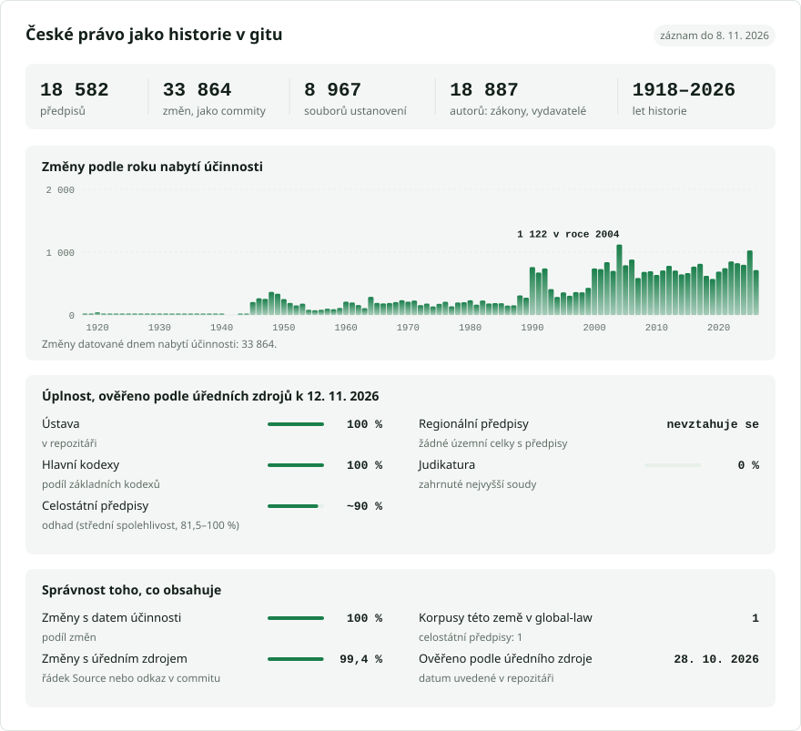

# Česko: historie práva v gitu

**Čeština** · **[Or read it in English](README.en.md)**

<picture>
<source media="(prefers-color-scheme: dark)" srcset="data/cs/effort-dark.svg">

</picture>

Právo Česka jako historie git: jeden soubor na předpis, jeden commit na každé znění v den, kdy nabylo účinnosti, a jako autor commitu předpis, který změnu provedl. `git blame` u každého řádku uvede předpis, který ho napsal; `git log` vypíše každou změnu předpisu; zvolené datum dá text účinný k tomuto dni.

Součást projektu [lexifina/global-law](https://github.com/lexifina/global-law), jedné historie git pro právo všech zemí: toto je vnitrostátní právo Česka, které global-law čte v `czechia/national/acts/`.

**Co obsahuje nyní:** Ústavu, Listinu a 20 924 předpisů a položek Sbírky zákonů, z toho 18 583 se všemi konsolidovanými zněními, která e-Sbírka publikuje; 35 637 obecně závazných vyhlášek a nařízení od 6 182 obcí a krajů; 6 804 položek Úředního listu (1945-1961); 2 263 smluv Sbírky mezinárodních smluv; 9 819 předpisů EU v češtině; 5 633 návrhů zákonů a vládních návrhů, označených jako texty, které nejsou právem; a 1 188 opatření, metodik a smluv regulátorů a ministerstev. [`PLAN.md`](PLAN.md) uvádí všechny části, které má tento repozitář obsahovat, a jak daleko je každá z nich.

Každý předpis je jeden soubor na své cestě ELI, `sb/<rok>/<číslo>.md` (`sb/2006/262.md` je zákoník práce, 262/2006 Sb.); Ústava je [`sb/1993/1.md`](sb/1993/1.md) a Listina základních práv a svobod [`sb/1993/2.md`](sb/1993/2.md).

Text je v češtině, tak jak ho publikuje e-Sbírka. Anglický překlad není součástí tohoto záznamu.

## Otázky jako příkazy git

| Otázka | Příkaz |
| --- | --- |
| Každá změna zákoníku práce | `git log -p --word-diff -- sb/2006/262.md` |
| Který předpis napsal každý řádek zákoníku práce? | `git blame sb/2006/262.md` |
| Každé znění zákoníku práce se dnem, kdy nabylo účinnosti | `git log --format="%h %(trailers:key=In-force,valueonly,separator=) %an" -- sb/2006/262.md` |
| Zákoník práce ve znění účinném k 1. lednu 2015 | `python tools/czlaw.py on 2015-01-01 sb/2006/262.md` |

**Mimo git** tento záznam také veřejně a zdarma provozujeme:

- **[Zeptejte se Claude na české právo](https://global-law.lexifina.com/v1/try_claude?country=czechia)**: otevře Claude s připravenou první otázkou.
- **[Zeptejte se ChatGPT](https://global-law.lexifina.com/v1/try_chatgpt?country=czechia)**: stejná otázka v ChatGPT.
- **[Hledejte v českém právu na našem webu](https://lexifina.com/law?country=czechia&q=dovolen%C3%A1)**: hledání „dovolená“, s textem každého ustanovení a jeho zněními, bez účtu.
- **[REST API pro vývojáře](https://global-law.lexifina.com/v1/search_law?query=dovolen%C3%A1&jurisdiction=czechia)**: stejné hledání jako JSON, bez klíče. Dokumentace je [zde](https://lexifina.com/api/global-law).

Oba asistenti čtou záznam přes bezplatný konektor Global law (MCP, `https://global-law.lexifina.com/mcp`); poprvé vám chat dá odkaz, kterým se konektor přidá. Ptejte se česky nebo anglicky.

**Snadno ho provozujte sami.** Stačí git a Python a nástroje běží na vašem počítači:

```sh
git clone --depth 1 https://github.com/lexifina/global-law && cd global-law
python3 tools/countries.py add czechia/national/acts
python3 tools/law.py show 2026-01-01 czechia/national/acts/sb/2006/262.md
```

Otevřený v Claude Code, Cursoru, VS Code nebo Codexu klon spustí i místní server MCP se stejnými nástroji ([MCP.md](https://github.com/lexifina/global-law/blob/main/MCP.md)).

## Data

Každý commit je datován v poledne pražského času (Europe/Prague) dnem, kdy znění nabylo účinnosti, a tento den nese v traileru `In-force:`:

- u každého konsolidovaného znění den, který mu dává e-Sbírka (`znění-datum-účinnosti-od`);
- kde e-Sbírka publikuje znění dříve, než je celé účinné, končí každý fragment, který ještě účinný není, poznámkou `*(účinnost od RRRR-MM-DD)*` až do tohoto dne;
- git neumí uložit data před rokem 1970, proto je 4 889 dřívějších commitů datováno od 1970-01-01 po jedné sekundě a skutečný den je v `In-force:`. Na datum se ptejte nástrojem `tools/czlaw.py`, ne `git log --before`.

Každá změna je připsána předpisu, který ji provedl, tak jak ho e-Sbírka pojmenovává (`Zákon č. 71/2012 Sb.`), podle konsolidačních vazeb e-Sbírky; kde vazby neuvádějí, který předpis to byl, je připsána `e-Sbírka` (2 682 z 36 217 změn). Opravy, které e-Sbírka později provede v již zveřejněném znění, se připojují jako samostatné commity (`Kind: correction`) a větev `future` obsahuje znění, která měla nabýt účinnosti po 2026-10-28.

## Jak se kontroluje

- `tools/build/check_repo.py` znovu vykreslí každé konsolidované znění z datových sad e-Sbírky a porovná ho bajt po bajtu se souborem v gitu ke dni, kdy nabylo účinnosti; zrušené předpisy musí od posledního dne účinnosti chybět.
- Písmena a číslice každého znění se rovnají písmenům a číslicím vlastních textů fragmentů e-Sbírky, bez ohledu na rozvržení Markdownu.
- `tools/test_repo.py` ověřuje, že blame, nástroj pro data a výše uvedené příkazy fungují. Výsledky a opakované sestavení se stejnými hashi jsou v [`REPRODUCE.md`](REPRODUCE.md).
- Historie se jen doplňuje: `main` jen roste a žádný zveřejněný commit se nepřepisuje.
- [vulnerabilities/](vulnerabilities/): možné legislativní chyby v českém právu, které našly detektory z global-law a které byly ručně ověřeny.

## Co neukazuje

- **Judikaturu.** Zatím žádnou: 105 034 rozhodnutí Ústavního soudu, 165 523 rozhodnutí Nejvyššího soudu a 84 449 rozhodnutí Nejvyššího správního soudu a asi 700 000 rozhodnutí nižších soudů se plánuje (viz `PLAN.md`).
- **Většinu práva před rokem 1945.** Z přibližně 6 340 číslovaných předpisů z let 1918-1938 je zde 593; léta 1939-1945 a rakouské a uherské právo recipované v roce 1918 zde nejsou.
- **Znění, která e-Sbírka nekonsoliduje.** Položky publikované jen ve znění vyhlášeném mají jeden text a znění, která e-Sbírka označuje jako nikdy neúčinná, jsou vynechána.
- **Který předpis provedl některé změny.** 2 682 změn je stále připsáno `e-Sbírka`; [data/credits/](data/credits/) uvádí předpis u většiny ostatních, které vazby e-Sbírky nechávají otevřené.
- **Stálé identifikátory fragmentů.** e-Sbírka je může měnit až do 15. ledna 2027; text na nich nezávisí.

## Zdroje

| Zdroj | Druh | Dřívější znění | Poznámky |
| --- | --- | --- | --- |
| [e-Sbírka](https://www.e-sbirka.cz) (Ministerstvo vnitra) | Úřední sbírka: Sbírka zákonů, Sbírka mezinárodních smluv, Úřední list | ano, každé konsolidované znění | Otevřené datové sady; právně závazný je text vyhlášený ve Sbírce |
| [Sbírka právních předpisů územních samosprávných celků](https://sbirkapp.gov.cz) | Místní předpisy | tak, jak jsou zveřejněny | Obecně závazné vyhlášky a nařízení obcí a krajů |
| [EUR-Lex](https://eur-lex.europa.eu) | Právo EU v češtině | tak, jak je zveřejněno | Český text Úředního věstníku |
| [psp.cz](https://www.psp.cz), [senat.cz](https://www.senat.cz), vládní ODok | Návrhy zákonů, hlasování, vládní návrhy | tak, jak jsou zveřejněny | Označeny jako texty, které nejsou právem |
| ČNB, portal.gov.cz, MPSV | Opatření regulátorů, věstníky ministerstev, kolektivní smlouvy | tak, jak jsou zveřejněny | Každý tak, jak ho vydává jeho vydavatel |

## Licence

Viz [`LICENSE`](LICENSE). Otevřené datové sady e-Sbírky neobsahují autorská díla, nejsou autorskoprávně chráněnou databází a nejsou chráněny zvláštním právem pořizovatele databáze (podmínky užití v Národním katalogu otevřených dat, data.gov.cz, přiřazené k CC0). Historie, zprávy commitů a nástroje jsou CC0 1.0.

Žádný model AI nenapsal ani nezměnil právní text; skripty napsal model AI (viz [`REPRODUCE.md`](REPRODUCE.md)).

Toto je překlad anglické verze ([README.en.md](README.en.md)); pokud se liší, platí anglická verze.

## Jak je to aktuální

- [monitoring/](monitoring/README.md): každé čtení e-Sbírky a ostatních zdrojů, kdy proběhlo a co z něj vzešlo (nové, změněné a zrušené předpisy); po měsících v [monitoring/checks/](monitoring/checks/), strojově v [data/checks/](data/checks/)
- [WATCHING.md](WATCHING.md): každý oficiální zdroj, co se na něm čte, jak často a kdy naposledy
- [FRESHNESS.md](FRESHNESS.md): kdy byla historie naposledy porovnána s e-Sbírkou a které předpisy tu zatím nejsou a proč

## Vizualizace

[visualisations/](visualisations/): české právo ve 20 grafech, nakreslených z tohoto repozitáře.

Mimo jiné:

- Kdo navrhuje zákony, co s nimi dělají Senát a prezident a jak hlasuje Sněmovna
- Co obsahuje Sbírka zákonů, jak často se mění a kdy předpisy končí
- Smluvní partneři, vyhlášky obcí, minimální mzda a úrok z prodlení

## Více

Z repozitáře [lexifina/global-law](https://github.com/lexifina/global-law) (v angličtině):

- [FEATURES.md](https://github.com/lexifina/global-law/blob/main/FEATURES.md): všechny funkce a co musí každý korpus podporovat (`git blame`, `law.py`, nástroje MCP)
- [FAQ.md](https://github.com/lexifina/global-law/blob/main/FAQ.md): otázky a odpovědi · [CONTRIBUTING.md](https://github.com/lexifina/global-law/blob/main/CONTRIBUTING.md): navrhování změn · [MCP.md](https://github.com/lexifina/global-law/blob/main/MCP.md): MCP server · [REPRODUCE.md](https://github.com/lexifina/global-law/blob/main/REPRODUCE.md): jak byl vytvořen · [CHANGELOG.md](https://github.com/lexifina/global-law/blob/main/CHANGELOG.md)
- [FRESHNESS.md](https://github.com/lexifina/global-law/blob/main/FRESHNESS.md): jak aktuální je každý korpus · [Monitorování](https://github.com/lexifina/global-law/tree/main/monitoring): zda aktualizace fungují · [WATCHING.md](https://github.com/lexifina/global-law/blob/main/WATCHING.md): jak se u každého úředního zdroje sledují změny
- [performance/](https://github.com/lexifina/global-law/tree/main/performance): jak rychlé jsou nástroje, změřeno
- [visualisations/](https://github.com/lexifina/global-law/tree/main/visualisations): grafy a vazby napříč právem celého světa
- [Zranitelnosti](https://github.com/lexifina/global-law/tree/main/vulnerabilities): chyby v předpisech tak, jak byly vyhlášeny
