# Czech law in 20 charts

[Čeština](README.md)

Charts on every country's law, from the whole of global-law: [global-law visualisations/](https://github.com/lexifina/global-law/tree/main/visualisations). These are the charts on Czechia alone.

Twenty charts on Czech law, drawn only from the data in this repository: the acts of the Collection of Laws and every change to them, the Official Journal of 1945–1961, the Collection of International Treaties, the Chamber of Deputies' prints and votes, the ordinances of municipalities and regions, and tables of the numbers that acts set.

Open [`ceske-pravo-ve-20-grafech.html`](ceske-pravo-ve-20-grafech.html) in a browser. The page is one file with all its data inside; it loads only the d3 and topojson libraries, the world map of chart 18 and its fonts from the web. The controls at the top right switch the language (Czech or English) and the theme (light or dark). Each chart names its data path in the repository, its record count and its limits, and has a table of every number under it. Hover over a mark for the exact values.

The charts are descriptive: they show what the sources record, not why.

## The charts

### I. The Chamber and the Senate

1. **Who proposes laws and who gets them passed.** Bills filed and bills that became law, by term: 78% of government bills, 27% of MPs' bills.
   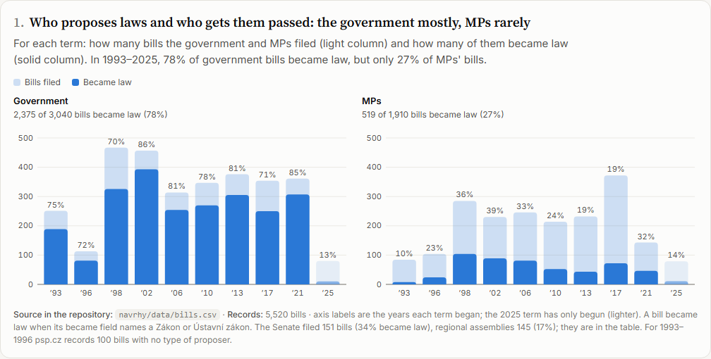
2. **From filing to the Collection.** How long a law takes from filing in the Chamber to promulgation, by term.
   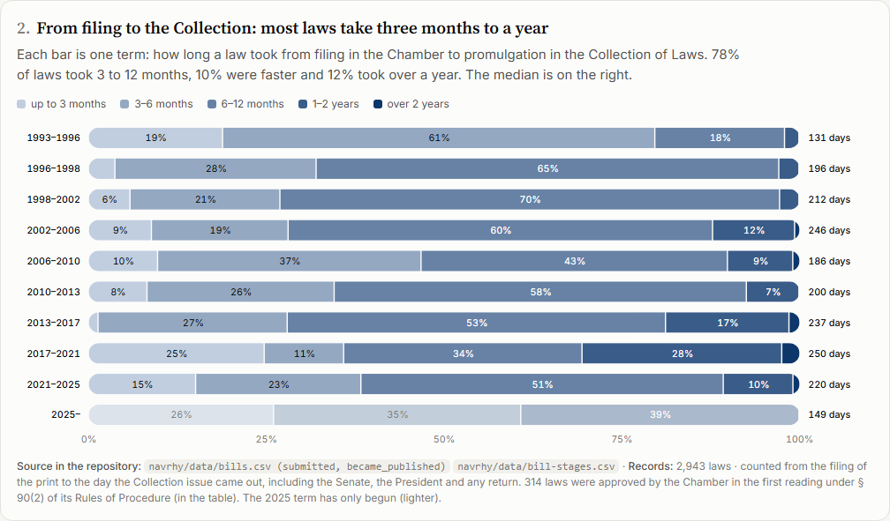
3. **What the Senate does with the Chamber's bills.** Approved, passed by lapse of time, returned or rejected, and what the Chamber did next.
   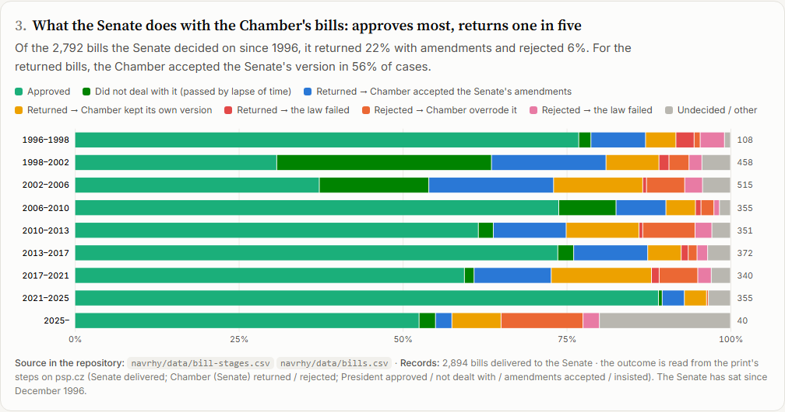
4. **The presidential veto.** Every law returned by Havel, Klaus, Zeman and Pavel, and whether the Chamber overrode it.
   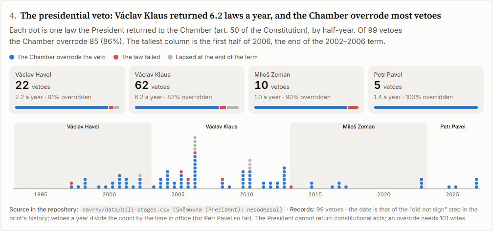
5. **How united MPs elected on the same list vote.** The Rice index by electoral list and term.
   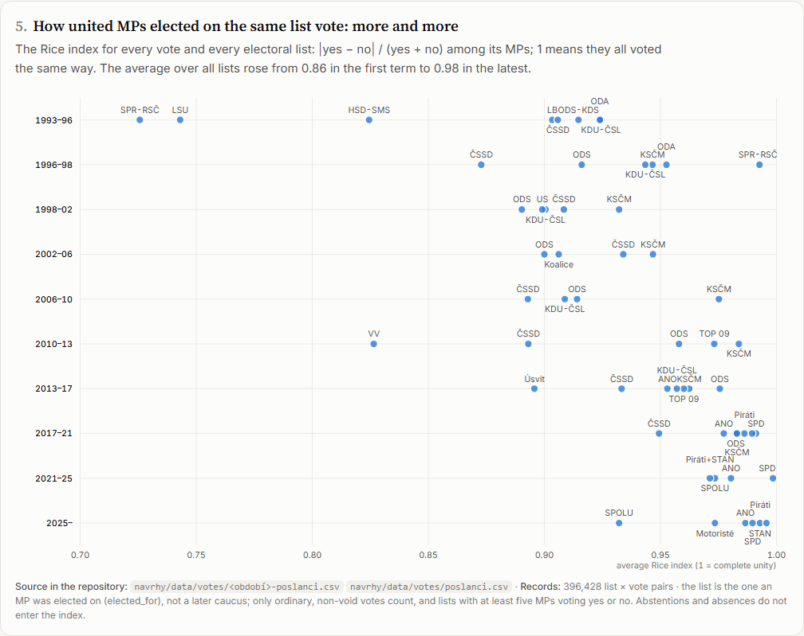
6. **Laws pass by wide majorities.** The yes votes in the final vote on every law.
   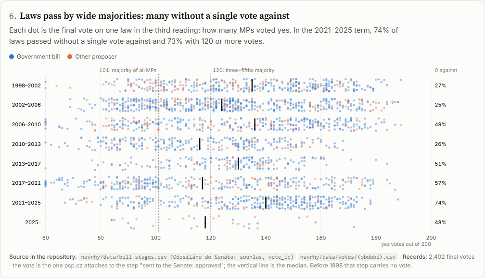
7. **When the Chamber votes.** Every vote since 1993 by weekday and hour.
   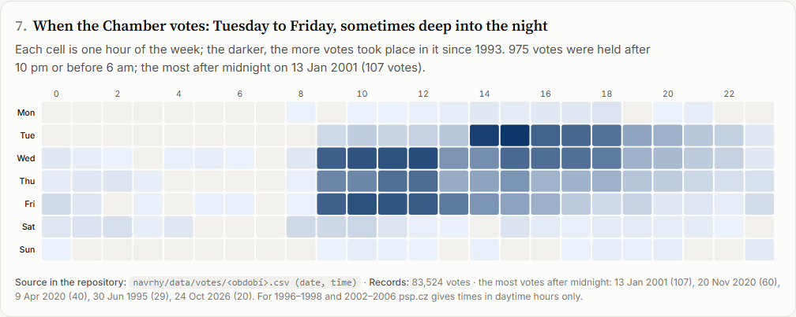

### II. The Collection of Laws

8. **How many items the Collection publishes.** Each year since 1945, by kind.
   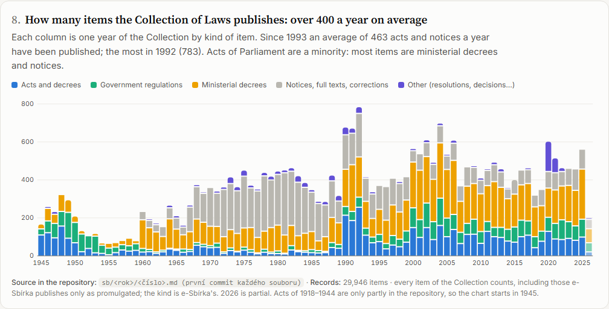
9. **What from the past is still in force.** Consolidated acts in force today by the period they were promulgated in.
   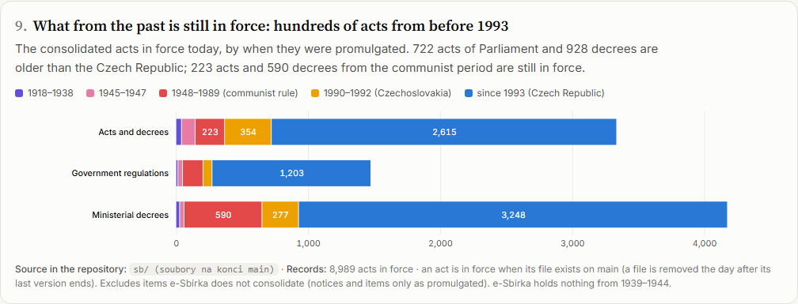
10. **The Official Journal 1945–1961.** Decrees by topic: nationalisation, prices and rationing.
    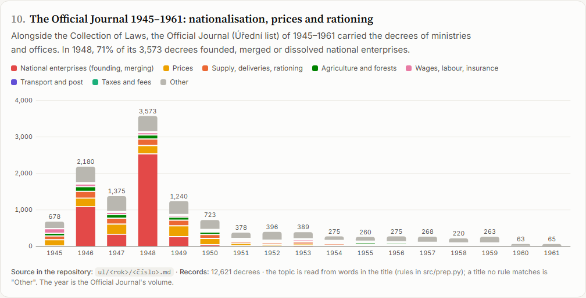
11. **The pace of amendment.** New versions of acts taking effect each year.
    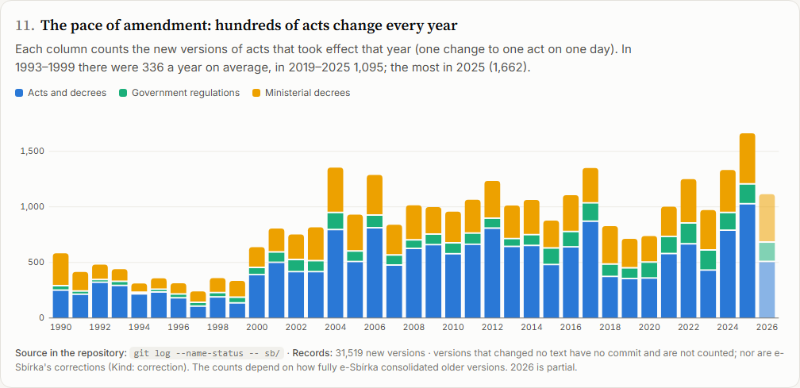
12. **The most-changed laws.** Changes per year for 25 acts, 1990–2026.
    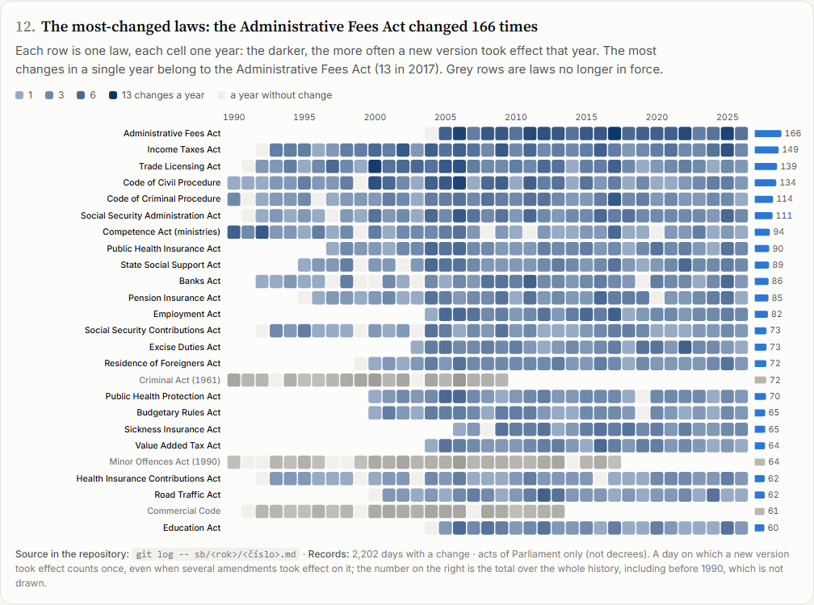
13. **1 January and 1 July.** How often changes take effect on the default days that apply since 31 December 2019.
    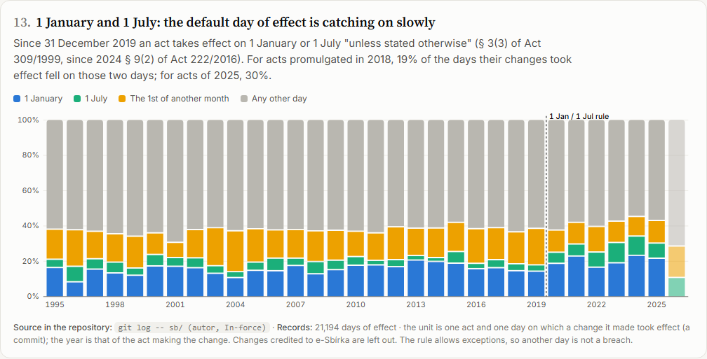
14. **Omnibus amendments.** How many other acts each amending act changed.
    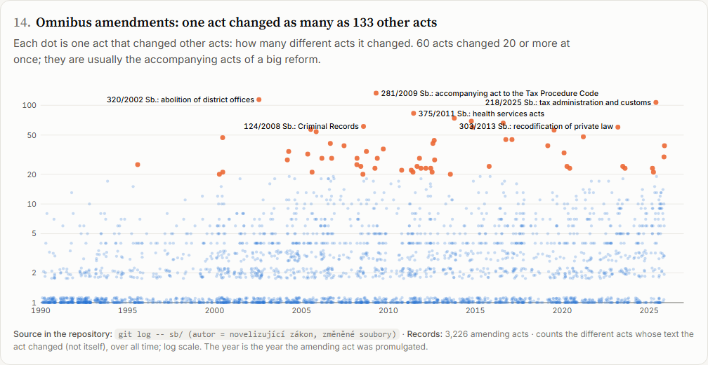
15. **When acts end.** Acts ceasing to have effect each year, including the 1,599 obsolete acts repealed by Act 276/2023 in 2024.
    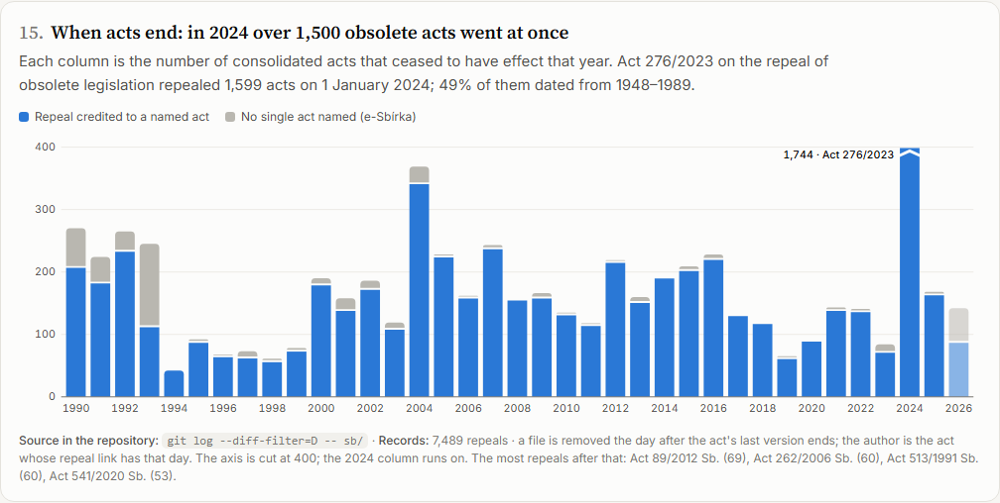

### III. The Constitutional Court, the European Union and treaties

16. **The Constitutional Court as negative legislator.** Findings recorded as the author of a change to an act.
    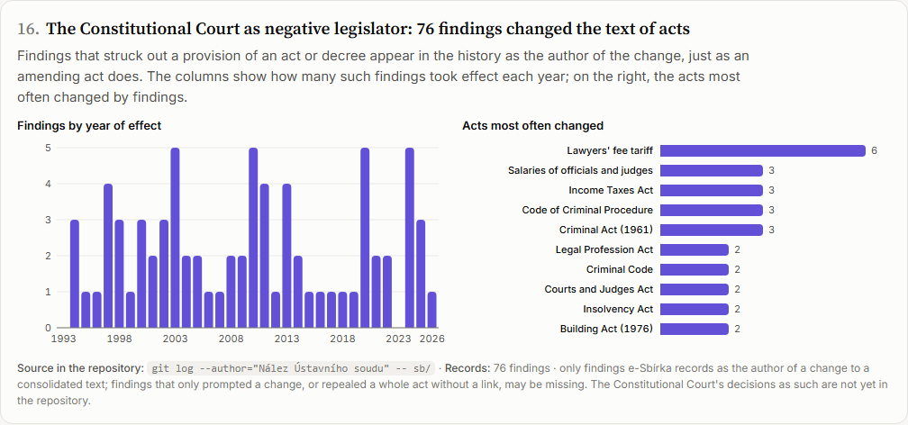
17. **The European agenda.** Government bills the Chamber marks as related to EU law.
    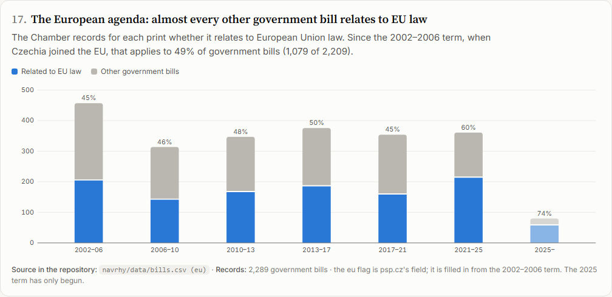
18. **Who Czechia signs treaties with.** Treaty notices by the other party, on a map and by decade.
    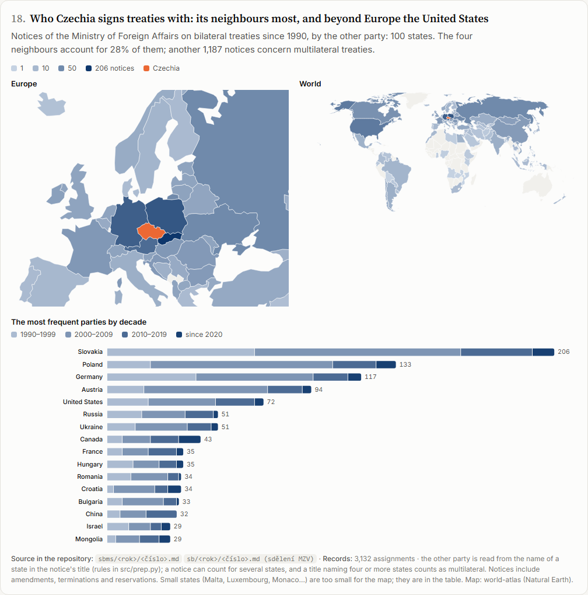

### IV. Municipalities and regions

19. **What municipalities legislate on.** Ordinances and regulations by topic and year of effect.
    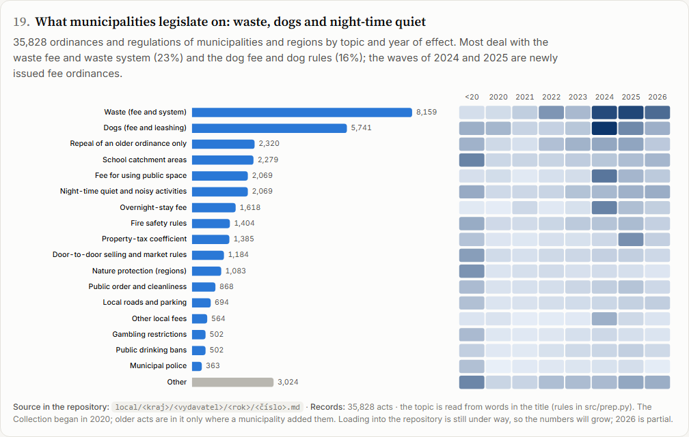

### V. Numbers the law sets

20. **The minimum wage and default interest.** Every amount since 1991, and default interest against the Czech National Bank's rate.
    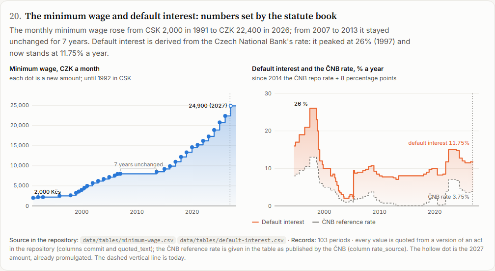

## Data

As of commit `aa02aa05dc` (15 November 2026).

| Dataset | Where in the repository | Records | Coverage |
| --- | --- | ---: | --- |
| Git history | branch `main` | 124,342 commits | the date of each law commit is the day the version took effect (`In-force:`) |
| Collection of Laws | `sb/<year>/<number>.md` | 30,540 items; 8,993 consolidated acts in force | 1945–2026; 1918–1938 only in part, 1939–1944 not at all |
| Official Journal | `ul/` | 12,621 decrees | 1945–1961 |
| Collection of International Treaties | `sbms/` | 2,263 notices | 2000–2026, with the treaty notices of the Collection of Laws before |
| Chamber prints and votes | `navrhy/data/` | 11,332 prints (5,520 bills); 83,524 votes; 16,690,400 individual votes | 1993–2026 |
| Local acts | `local/` | 35,828 ordinances and regulations | in effect since 2020; older ones only where a municipality added them |
| Tables | `data/tables/` | minimum wage, default interest | every row quotes a version of an act |

## Limits

- **The history is as complete as e-Sbírka's consolidation.** Charts 9, 11, 12 and 15 count versions and repeals that e-Sbírka records; versions that changed no text have no commit.
- **Categories are read from titles.** The topic of Official Journal decrees (chart 10), the other party to a treaty (18) and the topic of local acts (19) come from words in titles, by the rules in `src/prep.py`. Whatever no rule recognises is shown as "Other".
- **psp.cz data has gaps.** Final votes are linked to bills only from 1998 (chart 6); the vote times of 1996–1998 and 2002–2006 are daytime only (chart 7).
- **Local acts are still being loaded,** so chart 19 will grow. Case law is not yet in the repository; chart 16 shows only findings that changed the text of an act.
- **Partial periods** (2026, the 2025 term) are drawn lighter and labelled as such.

## Rebuilding

```sh
python visualisations/src/make.py            # git log + tables -> src/.build/ -> ceske-pravo-ve-20-grafech.html
node visualisations/src/stills.cjs           # images for these READMEs (needs Playwright; PLAYWRIGHT=<path> if not global)
```

`make.py` reads everything from git objects, so it also works in a blobless or `--no-checkout` clone. It reads `origin/main` (or `HEAD`) by default; `--ref` picks another branch or commit. It writes nothing into the repository except the page and the `src/.build/` folder (which git ignores).

| File | What it does |
| --- | --- |
| `src/make.py` | extracts the history and the tables into `src/.build/`, then runs `prep.py` and `build.py` |
| `src/prep.py` | computes every number for the 20 charts and the data profile into `src/.build/data.json` |
| `src/page.tpl.html` | the page: text in both languages, the charts (d3), the tables |
| `src/build.py` | puts `data.json` into the template and writes the page |
| `src/stills.cjs` | draws each chart as a PNG into `stills/cs/` and `stills/en/` |
