# České právo ve 20 grafech

[English](README.en.md)

Grafy o právu všech zemí z celého global-law: [global-law visualisations/](https://github.com/lexifina/global-law/tree/main/visualisations). Zde jsou jen grafy o Česku.

Dvacet grafů o českém právu nakreslených jen z dat tohoto repozitáře: předpisy Sbírky zákonů a každá jejich změna, Úřední list 1945–1961, Sbírka mezinárodních smluv, sněmovní tisky a hlasování Poslanecké sněmovny, vyhlášky a nařízení obcí a krajů a tabulky čísel, která stanoví právní předpisy.

Otevřete [`ceske-pravo-ve-20-grafech.html`](ceske-pravo-ve-20-grafech.html) v prohlížeči. Stránka je jeden soubor se všemi daty; z internetu načítá jen knihovny d3 a topojson, mapu světa pro graf 18 a písma. Vpravo nahoře se přepíná jazyk (čeština nebo angličtina) a motiv (světlý nebo tmavý). U každého grafu je uvedena cesta k datům v repozitáři, počet záznamů a omezení a pod ním tabulka se všemi čísly. Po najetí myší na značku se zobrazí přesné hodnoty.

Grafy jsou popisné: ukazují, co zdroje zaznamenávají, ne proč.

## Grafy

### I. Sněmovna a Senát

1. **Kdo navrhuje zákony a komu projdou.** Podané návrhy zákonů a ty, které se staly zákonem, podle volebního období: 78 % vládních návrhů, 27 % návrhů poslanců.
   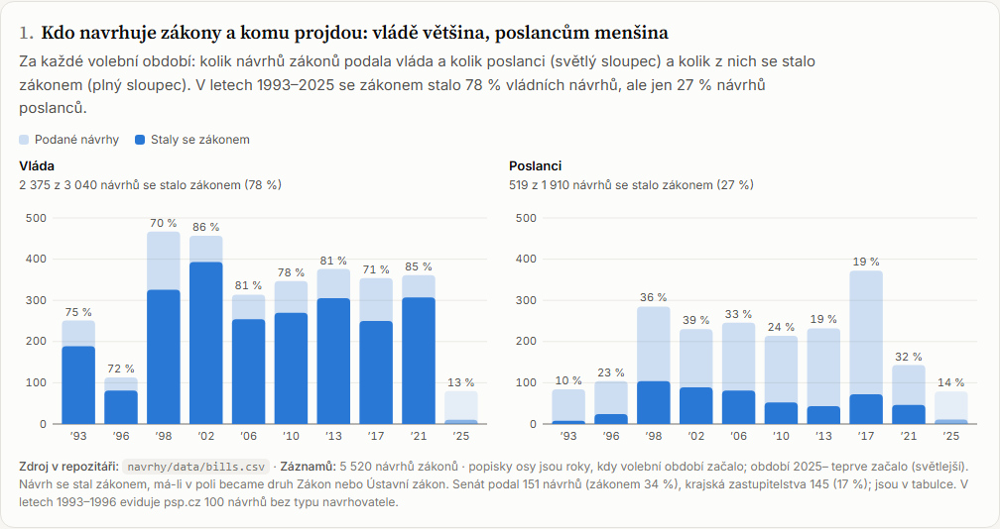
2. **Od předložení do Sbírky.** Jak dlouho trvá cesta zákona od předložení Sněmovně do vyhlášení, podle volebního období.
   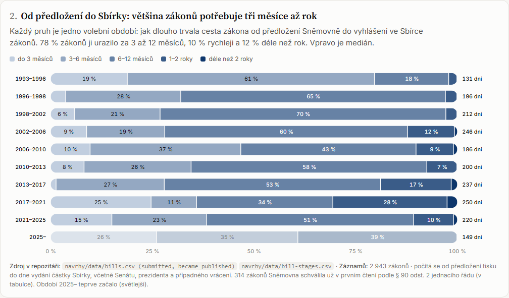
3. **Co dělá Senát se zákony ze Sněmovny.** Schválil, nezabýval se, vrátil nebo zamítl, a co pak udělala Sněmovna.
   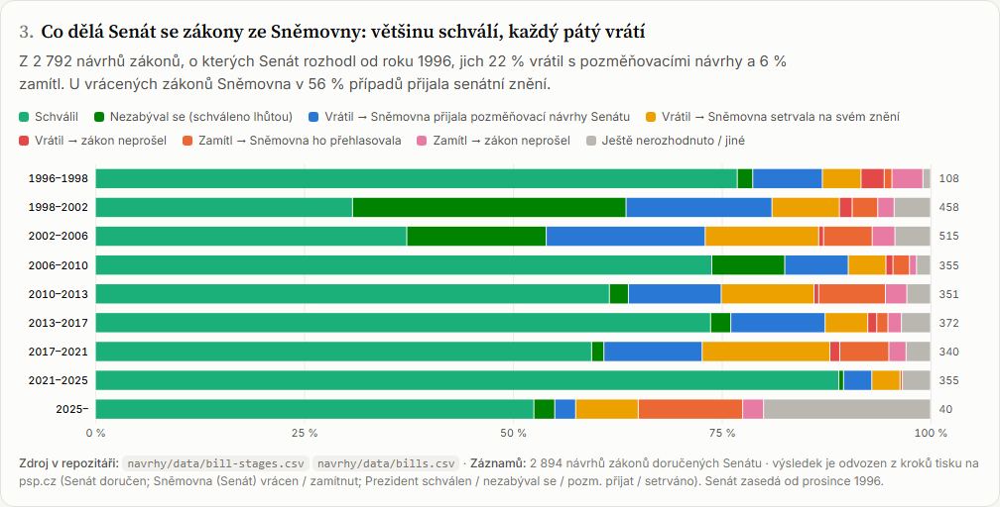
4. **Prezidentské veto.** Každý zákon, který vrátili Havel, Klaus, Zeman a Pavel, a zda ho Sněmovna přehlasovala.
   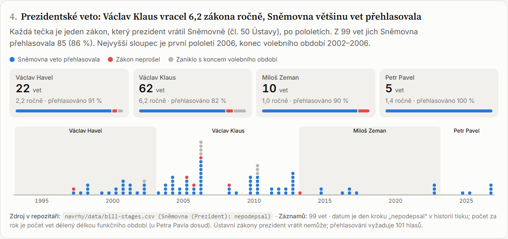
5. **Jak jednotně hlasují poslanci téže kandidátky.** Riceův index podle kandidátky a volebního období.
   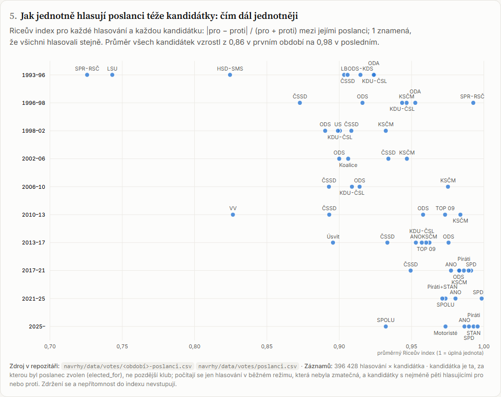
6. **Zákony procházejí širokou většinou.** Hlasy pro v závěrečném hlasování o každém zákoně.
   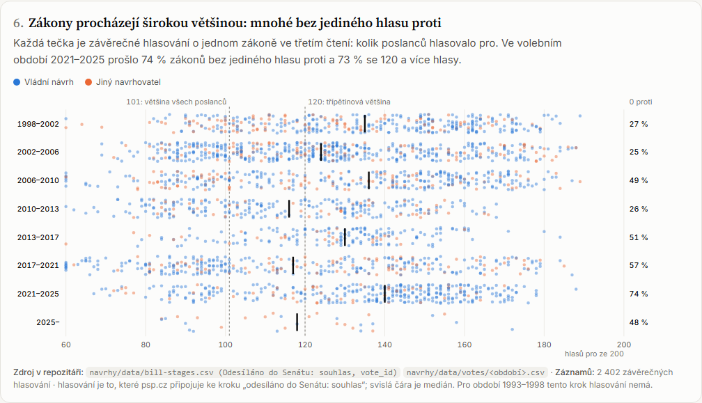
7. **Kdy Sněmovna hlasuje.** Každé hlasování od roku 1993 podle dne v týdnu a hodiny.
   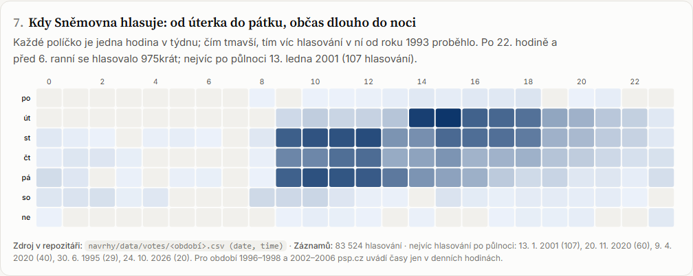

### II. Sbírka zákonů

8. **Kolik předpisů vychází ve Sbírce zákonů.** Každý rok od roku 1945, podle druhu.
   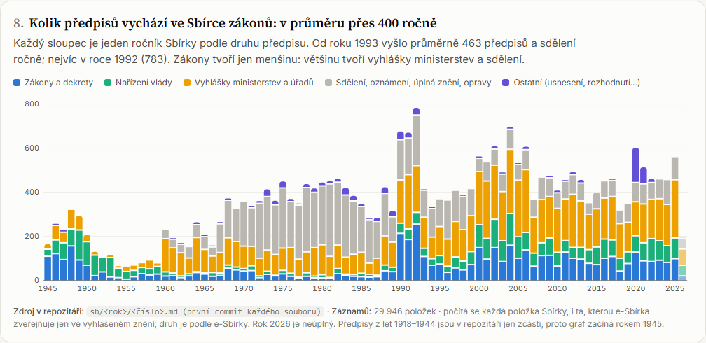
9. **Co z minulosti stále platí.** Konsolidované předpisy v účinnosti podle doby vyhlášení.
   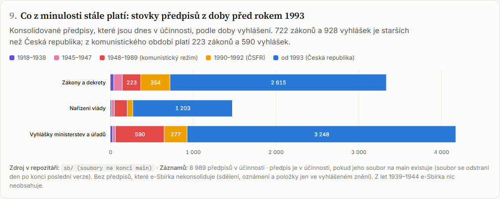
10. **Úřední list 1945–1961.** Vyhlášky podle tématu: znárodnění, ceny a příděly.
    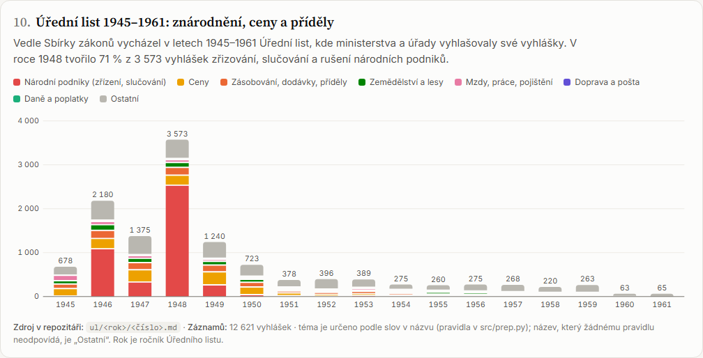
11. **Tempo novelizací.** Nová znění předpisů, která nabyla účinnosti v jednotlivých letech.
    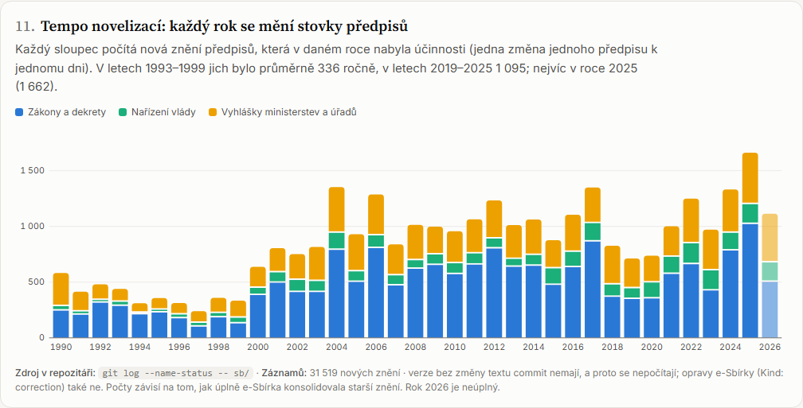
12. **Nejčastěji měněné zákony.** Změny za rok u 25 zákonů, 1990–2026.
    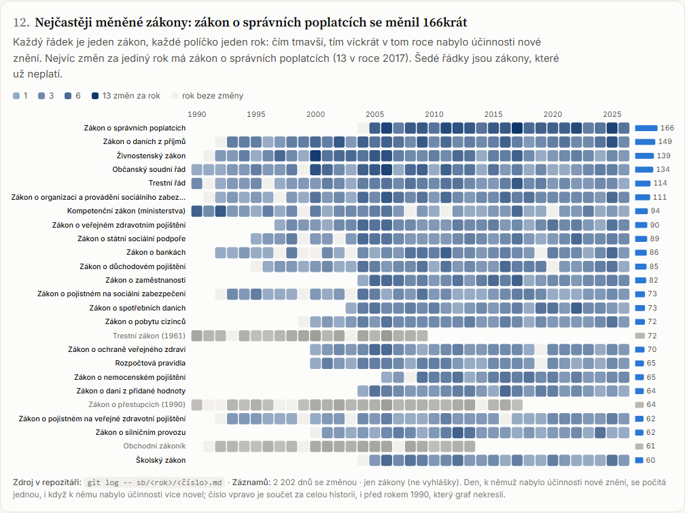
13. **1. leden a 1. červenec.** Jak často nabývají změny účinnosti ve výchozí dny, které platí od 31. prosince 2019.
    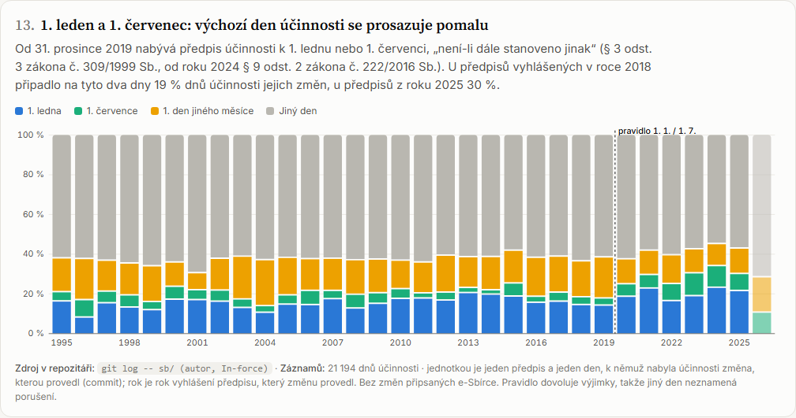
14. **Hromadné novely.** Kolik jiných předpisů každý novelizující zákon změnil.
    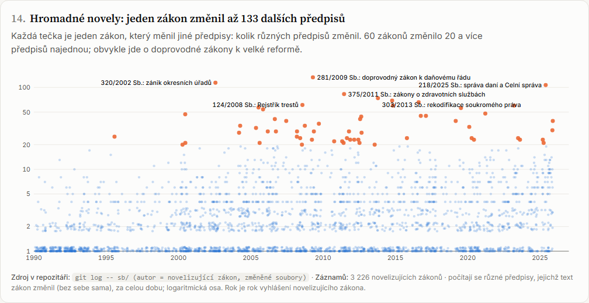
15. **Kdy předpisy končí.** Předpisy, které v jednotlivých letech pozbyly účinnosti, včetně 1 599 obsoletních předpisů zrušených zákonem č. 276/2023 Sb. v roce 2024.
    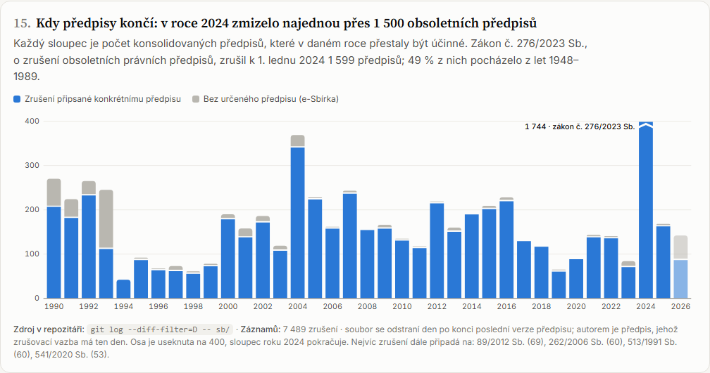

### III. Ústavní soud, Evropská unie a smlouvy

16. **Ústavní soud jako negativní zákonodárce.** Nálezy, které jsou v historii autorem změny předpisu.
    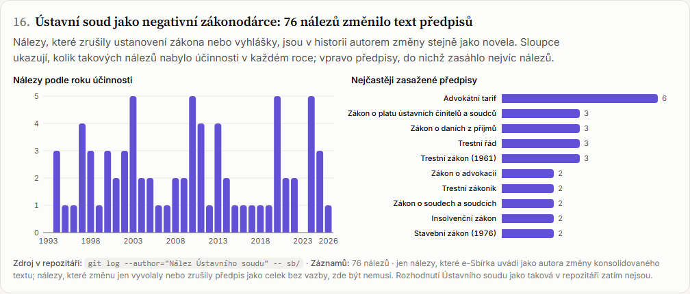
17. **Evropská agenda.** Vládní návrhy zákonů, které Sněmovna eviduje jako související s právem EU.
    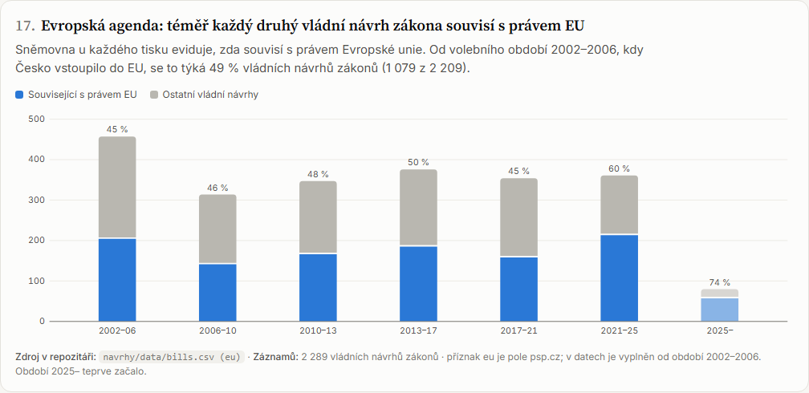
18. **S kým Česko uzavírá smlouvy.** Sdělení o smlouvách podle smluvní strany, na mapě a podle desetiletí.
    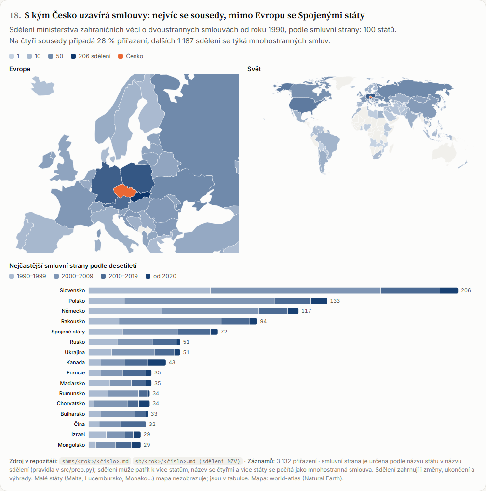

### IV. Obce a kraje

19. **O čem obce vydávají vyhlášky.** Vyhlášky a nařízení podle tématu a roku účinnosti.
    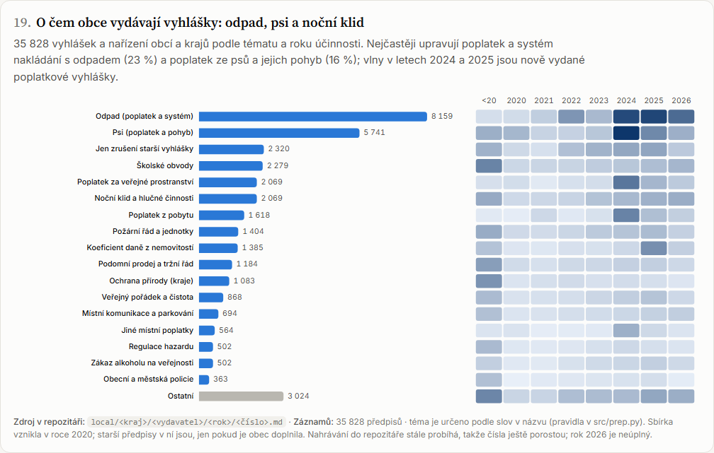

### V. Čísla, která stanoví právo

20. **Minimální mzda a úrok z prodlení.** Každá částka od roku 1991 a úrok z prodlení vedle sazby České národní banky.
    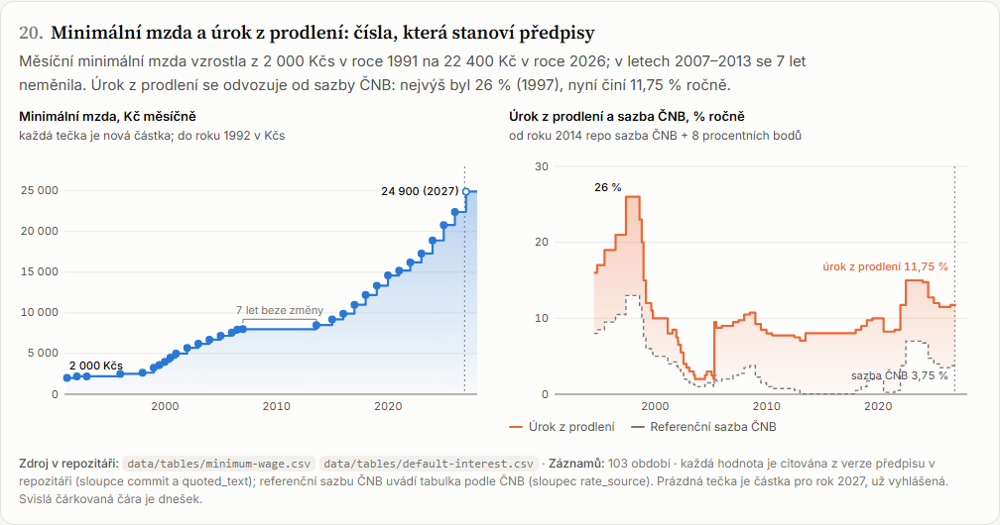

## Data

Stav ke commitu `aa02aa05dc` (15. listopadu 2026).

| Datová sada | Kde v repozitáři | Záznamů | Rozsah |
| --- | --- | ---: | --- |
| Historie gitu | větev `main` | 124 342 commitů | datum každého commitu se zněním předpisu je den, kdy znění nabylo účinnosti (`In-force:`) |
| Sbírka zákonů | `sb/<rok>/<číslo>.md` | 30 540 položek; 8 993 konsolidovaných předpisů v účinnosti | 1945–2026; z let 1918–1938 jen zčásti, z let 1939–1944 nic |
| Úřední list | `ul/` | 12 621 vyhlášek | 1945–1961 |
| Sbírka mezinárodních smluv | `sbms/` | 2 263 sdělení | 2000–2026, před tím sdělení o smlouvách ve Sbírce zákonů |
| Sněmovní tisky a hlasování | `navrhy/data/` | 11 332 tisků (5 520 návrhů zákonů); 83 524 hlasování; 16 690 400 hlasů poslanců | 1993–2026 |
| Předpisy obcí a krajů | `local/` | 35 828 vyhlášek a nařízení | účinné od roku 2020; starší jen ty, které obec doplnila |
| Tabulky | `data/tables/` | minimální mzda, úrok z prodlení | každý řádek cituje verzi předpisu |

## Omezení

- **Historie je tak úplná jako konsolidace e-Sbírky.** Grafy 9, 11, 12 a 15 počítají znění a zrušení, která e-Sbírka zaznamenává; znění, které nezměnilo text, nemá commit.
- **Kategorie se čtou z názvů.** Téma vyhlášek Úředního listu (graf 10), smluvní strana (18) a téma předpisů obcí (19) se určují podle slov v názvu, pravidly v `src/prep.py`. Co žádné pravidlo nepozná, je „Ostatní“.
- **Data psp.cz mají mezery.** Závěrečná hlasování jsou k tiskům připojena až od roku 1998 (graf 6); časy hlasování z let 1996–1998 a 2002–2006 jsou jen denní (graf 7).
- **Předpisy obcí se stále nahrávají,** graf 19 tedy poroste. Judikatura v repozitáři zatím není; graf 16 ukazuje jen nálezy, které změnily text předpisu.
- **Neúplná období** (rok 2026, volební období 2025–) jsou nakreslena světleji a tak označena.

## Jak grafy znovu vytvořit

```sh
python visualisations/src/make.py            # git log + tabulky -> src/.build/ -> ceske-pravo-ve-20-grafech.html
node visualisations/src/stills.cjs           # obrázky pro tyto README (potřebuje Playwright; PLAYWRIGHT=<cesta>, není-li globální)
```

`make.py` čte vše z objektů gitu, takže funguje i v klonu bez blobů nebo bez checkoutu. Ve výchozím stavu čte `origin/main` (nebo `HEAD`); `--ref` vybere jinou větev nebo commit. Do repozitáře nezapisuje nic kromě stránky a složky `src/.build/` (kterou git ignoruje).

| Soubor | Co dělá |
| --- | --- |
| `src/make.py` | vytáhne historii a tabulky do `src/.build/`, pak spustí `prep.py` a `build.py` |
| `src/prep.py` | spočítá všechna čísla pro 20 grafů a profil dat do `src/.build/data.json` |
| `src/page.tpl.html` | stránka: texty v obou jazycích, grafy (d3), tabulky |
| `src/build.py` | vloží `data.json` do šablony a zapíše stránku |
| `src/stills.cjs` | nakreslí každý graf jako PNG do `stills/cs/` a `stills/en/` |
