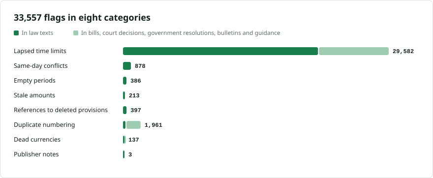

# Vulnerabilities in Czech law

[Čeština](README.md) · **English**

<picture>
<source media="(prefers-color-scheme: dark)" srcset="img/flags-by-category-dark.svg">

</picture>

The vulnerability detectors from [lexifina/global-law](https://github.com/lexifina/global-law/tree/main/vulnerabilities) look for mechanical mistakes in legislation: a rule applying "until" a date that has passed, a time limit extended only after it had run out, two amendments to the same act on the same day, a reference to a section that no longer exists. global-law's published list (9 November 2026) covered Czechia from an earlier, smaller copy of this repository, so this is a run over this repository only, as it stood at commit [`aa02aa0`](https://github.com/lexifina/czechia-law/commit/aa02aa05dc66bdff595c04995523e3955feed005) on 15 November 2026, with the Úřední list, local ordinances, treaties, EU law, bills and case law it now holds.

**In short:** the detectors raised 25,875 flags. A language model reviewed 201 of the strongest, arguing each one for and against; 74 survived. Checked by hand in this repository, two look like real drafting mistakes in Czech law, both recent. Act No. 73/2025 Coll. repealed §§ 56 to 56b of the Advocacy Act and moved their content to §§ 52e to 52n, but seven provisions still cite § 56 or § 56a. Act No. 19/2023 Coll. extended a transitional deadline of 31 December 2022 only from 24 January 2023, so for 23 days the rule had lapsed. Of the other 71, 43 come from how this repository is laid out (one file per act) or how its record credits changes, 3 are misreadings by a detector, 10 are lawful, 8 are spent rules, and 7 point to another act's sections. Later, this will be formalised in Lean, similar to our work on [the US tax code](https://lexifina.com/blog/formalizing-the-us-tax-code) and [US case law](https://lexifina.com/blog/formalizing-all-us-case-law-in-lean).

A flag is a prompt to look, not legal advice, and nothing here has been tested in court.

## Flags by category

| Category | What it looks for | Flags | In law texts | Reviewed | Survived review |
| --- | --- | ---: | ---: | ---: | ---: |
| Lapsed time limits | Text still applying a rule "until" a date that has passed | 21,380 | 17,110 | 41 | 0 |
| Same-day conflicts | Two acts changing the same act on the same day | 878 | 878 | 40 | 3 |
| Empty periods | A time limit extended by an act that took effect after it had run out | 352 | 352 | 40 | 33 |
| Stale amounts | An amount changed in one place but still standing elsewhere | 213 | 213 | 40 | 18 |
| References to deleted provisions | A provision citing a section that no longer exists | 494 | 494 | 40 | 20 |
| Duplicate numbering | Two units with the same number in one act | 1,961 | 273 | 0 | 0 |
| Dead currencies | Amounts in currencies no longer in use | 594 | 468 | 0 | 0 |
| Publisher notes | Notes that an amendment could not be carried out | 3 | 3 | 0 | 0 |

"In law texts" counts the Sbírka zákonů and the Úřední list, treaties, local ordinances, EU acts, regulators' measures and collective agreements. The other flags are in bills and government drafts, court decisions, government resolutions, ministry bulletins and guidance, which this repository also holds and labels as not law. The search for repeal gaps and retroactive dates found nothing to flag: an act is one file here, so a section removed and later restored leaves no deleted file to find, and the commits carry no publication date to compare with.

*Edge cases: the 74 flags that survived the review, grouped by what they turned out to be, and what the other flags are, in [EDGE-CASES.en.md](EDGE-CASES.en.md).*

## Problems found in this repository

- **One file per act** puts a whole act in front of detectors written for one file per provision: an amount quoted in an amending act's "replace X with Y" counts as the old amount "still standing", and two dates in unrelated sentences of one act read as a time limit and its extension (43 of the 74 survivors, in [Edge cases](EDGE-CASES.en.md)).
- **Changes credited to the act itself:** where e-Sbírka's links do not name the amending act, a change can be credited to the act on the day one of its own delayed parts took effect (Act No. 227/2009 Coll. in [Edge cases](EDGE-CASES.en.md)).
- **Metadata at the top of local ordinances and bills** (`sppsu_id`, `text_url`) is part of each file, so tools that scan the text read it too (48 "Deutsche Mark" flags are the letters "DM" inside those identifiers and links).

## Files

| File | What it holds |
| --- | --- |
| [data/flags.csv](data/flags.csv) | Every flag, one row per act and issue |
| [data/reviewed.csv](data/reviewed.csv) | The 201 flags the model reviewed, with its verdict and reason |
| [data/by_category.csv](data/by_category.csv) | The counts in the table above |
| [tools/](tools/) | The scripts that made this run |

Columns: `category` and `category_cs` (the category in English and Czech), `detector`, `kind` (`law` or `other`), `path` (the file in this repository), `date` (the date the flag turns on), `reference` (the act or line involved), `summary`, `score` (the detector's ranking, 0 to 1), `review` (`artefact`, `lawful` or `candidate_defect`), `survives_rebuttal`, `review_note` (the model's reason, in English), `url` (the act at the commit that was read, or, for an act repealed since, at the last commit that held it).

## How it was made

- **Detectors:** global-law's [vulnerabilities/scripts](https://github.com/lexifina/global-law/tree/main/vulnerabilities/scripts), run on this repository at commit `aa02aa0`. global-law replays this repository only up to an earlier commit, so the history table the detectors read was built from this repository's own commits (the author, the act that made each change, and the `In-force` and `Kind` trailers).
- **Model review:** gpt-5.4-mini, the 40 strongest flags per category, and for lapsed time limits also the 40 strongest in law texts; one pass says whether a flag is real, a second argues that it is not. Empty periods use global-law's own review for that category, on the 28 flags whose old and new date are in one sentence and the 12 shortest gaps, followed by the same second pass. Where a flag was reviewed twice, the later review is kept. global-law's own list used a different model.
- **Hand check:** every case that survived was read in this repository's history and texts, against the amending act as promulgated. The two open cases still need the Sbírka zákonů itself and any amendment not yet in force.

To report a correction, open an issue with the provision and an official source.

## Licence

The lists and notes are Lexifina's, dedicated to the public domain under CC0 1.0, like the rest of this repository's own contributions. Quoted law text is as e-Sbírka publishes it; see [LICENSE](../LICENSE).
