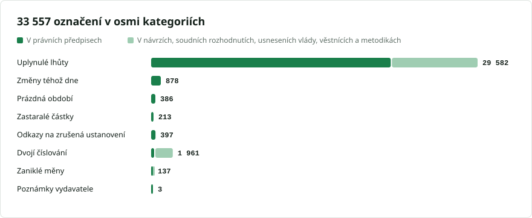

# Zranitelnosti v českém právu

**Čeština** · [English](README.en.md)

<picture>
<source media="(prefers-color-scheme: dark)" srcset="img/flags-by-category-dark.cs.svg">

</picture>

Detektory zranitelností z repozitáře [lexifina/global-law](https://github.com/lexifina/global-law/tree/main/vulnerabilities) hledají mechanické chyby v právních předpisech: pravidlo, které se stále uplatňuje „do“ data, jež už uplynulo, lhůtu prodlouženou až poté, co skončila, dvě novely téhož předpisu účinné téhož dne, odkaz na ustanovení, které už neexistuje. Seznam, který global-law zveřejnil 9. listopadu 2026, zahrnoval Česko podle starší a menší kopie tohoto repozitáře. Toto je proto kontrola jen tohoto repozitáře, ve stavu commitu [`aa02aa0`](https://github.com/lexifina/czechia-law/commit/aa02aa05dc66bdff595c04995523e3955feed005) z 15. listopadu 2026, včetně Úředního listu, obecně závazných vyhlášek obcí, mezinárodních smluv, práva EU, návrhů zákonů a judikatury, které nyní obsahuje.

**Stručně:** detektory vytvořily 33 557 označení. Jazykový model posoudil 212 nejsilnějších a u každého zvážil argumenty pro i proti; 61 obstálo. Po ruční kontrole v tomto repozitáři vypadají čtyři jako skutečné chyby v českém právu. Zákon č. 73/2025 Sb. zrušil § 56 až 56b zákona o advokacii a jejich obsah přesunul do § 52e až 52n, sedm míst však na § 56 nebo § 56a stále odkazuje (zjištěno při prvním posouzení tohoto repozitáře a dál označeno; toto posouzení vybralo jiná označení se stejným skóre). Tři prodloužení přišla až po skončení období, které prodlužovala: zákon č. 19/2023 Sb. prodloužil přechodnou lhůtu končící 31. prosince 2022 až s účinností od 24. ledna 2023, takže 23 dní pravidlo neplatilo; vyhláška č. 343/2001 Sb. prodloužila povolení doplňkových látek do krmiv platná do 30. září 2001 až od 4. října 2001 (tři dny, 11 označení); a zákon č. 39/2004 Sb. posunul konec roku 2003, nejzazší termín, do kterého mohla Komise pro cenné papíry prodloužit přeměnu investičního fondu, na konec roku 2004 až od 5. února 2004 (35 dní). Ze zbylých 48 jich 30 vychází z uspořádání tohoto repozitáře (jeden soubor na předpis) nebo z toho, jak jeho záznam připisuje změny, 6 je v souladu s právem, 3 jsou vyčerpaná pravidla a 9 odkazuje na ustanovení jiného předpisu. Později to bude formalizováno v Leanu, podobně jako naše práce na [daňovém zákoníku USA](https://lexifina.com/blog/formalizing-the-us-tax-code) a [judikatuře USA](https://lexifina.com/blog/formalizing-all-us-case-law-in-lean).

Označení je podnětem k bližšímu pohledu, ne právní radou, a nic z toho nebylo prověřeno soudem.

## Označení podle kategorií

| Kategorie | Co hledá | Označení | V předpisech | Posouzeno | Obstálo |
| --- | --- | ---: | ---: | ---: | ---: |
| Uplynulé lhůty | Text, který stále uplatňuje pravidlo „do“ data, jež už uplynulo | 29 582 | 21 709 | 52 | 0 |
| Změny téhož dne | Dva předpisy měnící týž předpis téhož dne | 878 | 878 | 40 | 3 |
| Prázdná období | Lhůta prodloužená předpisem, který nabyl účinnosti až po jejím uplynutí | 386 | 386 | 40 | 28 |
| Zastaralé částky | Částka změněná na jednom místě, která jinde dál stojí | 213 | 213 | 40 | 18 |
| Odkazy na zrušená ustanovení | Ustanovení odkazující na paragraf, který už neexistuje | 397 | 397 | 40 | 12 |
| Dvojí číslování | Dvě jednotky se stejným číslem v jednom předpisu | 1 961 | 273 | 0 | 0 |
| Zaniklé měny | Částky v měnách, které se už nepoužívají | 137 | 50 | 0 | 0 |
| Poznámky vydavatele | Poznámky, že novelu nebylo možné provést | 3 | 3 | 0 | 0 |

„V předpisech“ zahrnuje Sbírku zákonů a Úřední list, mezinárodní smlouvy, obecně závazné vyhlášky obcí a krajů, akty EU, opatření regulátorů a kolektivní smlouvy. Ostatní označení jsou v návrzích zákonů a vládních materiálech, soudních rozhodnutích, usneseních vlády, věstnících ministerstev a metodikách, které tento repozitář také obsahuje a označuje jako texty, jež nejsou právními předpisy. Hledání uplynulých lhůt nyní čte i data psaná s mezerami („31. 12. 2020“) a konec roku („do konce roku 2020“); v předpisech takto čte 27 157 spojení s datem, které už uplynulo, a stále vynechává 1 695 spojení, která uvádějí jen měsíc nebo rok: „do roku 2012“ nebo samotný rok (1 113, mezi nimi i množství jako „do 2000 kg“), „do června 2020“ (331), „do konce června 2020“ (220), „do konce kalendářního roku“ a podobná (28) a 3 jiná. Hledání mezer po zrušení a zpětných dat nenašlo nic: předpis je zde jeden soubor, takže paragraf zrušený a později obnovený nezanechá žádný smazaný soubor, a commity nenesou datum vyhlášení, se kterým by šlo účinnost porovnat.

*Hraniční případy: 61 označení, která obstála při posouzení, seskupená podle toho, čím se ukázala být, dvě z prvního posouzení a co jsou ostatní označení, v [EDGE-CASES.md](EDGE-CASES.md).*

## Problémy nalezené v tomto repozitáři

- **Jeden soubor na předpis** předkládá celý předpis detektorům psaným pro jeden soubor na ustanovení: částka citovaná v novelizačním bodě („částka X se nahrazuje částkou Y“) se počítá jako stará částka, která „dál stojí“, a dvě data v nesouvisejících větách jednoho předpisu se čtou jako lhůta a její prodloužení (28 z 61 obstálých, v [hraničních případech](EDGE-CASES.md)).
- **Změny nepřipsané žádnému předpisu:** kde odkazy e-Sbírky nejmenují novelu, je změna zapsána pod e-Sbírkou ke dni jejího znění a záznam neukazuje, kdy se text změnil (nařízení č. 206/1947 Sb. a vyhláška č. 471/1947 Ú. l. I v [hraničních případech](EDGE-CASES.md)).
- **Metadata v záhlaví obecně závazných vyhlášek a návrhů zákonů** (`sppsu_id`, `text_url`, `soubor`, `soubor_sha256`) jsou součástí každého souboru, takže je čtou i nástroje, které prohledávají text: 3 označení „belgických franků“ jsou písmena „bef“ na konci kontrolního součtu souboru a 6 označení „německých marek“ jsou písmena „DM“ v názvu přiloženého souboru.

## Soubory

| Soubor | Co obsahuje |
| --- | --- |
| [data/flags.csv](data/flags.csv) | Každé označení, jeden řádek na předpis a problém |
| [data/reviewed.csv](data/reviewed.csv) | 212 označení, která posoudil model, s jeho verdiktem a odůvodněním |
| [data/by_category.csv](data/by_category.csv) | Počty z tabulky výše |
| [tools/](tools/) | Skripty, které tuto kontrolu provedly |

Sloupce: `category` a `category_cs` (kategorie anglicky a česky), `detector`, `kind` (`law` nebo `other`), `path` (soubor v tomto repozitáři), `date` (datum, ke kterému se označení vztahuje), `reference` (dotčený předpis nebo řádek), `summary`, `score` (pořadí podle detektoru, 0 až 1), `review` (`artefact`, `lawful` nebo `candidate_defect`), `survives_rebuttal`, `review_note` (odůvodnění modelu, anglicky), `url` (předpis v posouzeném commitu, nebo u předpisu mezitím zrušeného v posledním commitu, který ho obsahoval).

## Jak to vzniklo

- **Detektory:** [vulnerabilities/scripts](https://github.com/lexifina/global-law/tree/main/vulnerabilities/scripts) z global-law, spuštěné na tomto repozitáři v commitu `aa02aa0`. global-law přehrává tento repozitář jen do staršího commitu, proto tabulka historie, kterou detektory čtou, vznikla z vlastních commitů tohoto repozitáře (autor, tedy předpis, který změnu provedl, a trailery `In-force` a `Kind`). Detektory pak byly spuštěny znovu s opravami, které čtou data psaná s mezerami a konec roku, berou „nejpozději do“ jako lhůtu ke splnění povinnosti, čtou „a“ mezi čísly paragrafů jako výčet, ne jako rozsah, a nacházejí méně falešných měn.
- **Posouzení modelem:** gpt-5.4-mini, 40 nejsilnějších označení v každé kategorii a u uplynulých lhůt také 40 nejsilnějších v předpisech (celkem 52); první průchod říká, zda je označení skutečné, druhý argumentuje, že není. Prázdná období používají vlastní posouzení global-law pro tuto kategorii, na 25 označeních, u nichž stojí staré i nové datum v jedné větě, a na 15 nejkratších mezerách, a poté stejný druhý průchod. Po opravách byly uplynulé lhůty, odkazy na zrušená ustanovení a prázdná období posouzeny znovu; označení se stejným skóre se nyní berou v pevném pořadí, takže posouzený výběr se od prvního liší. Kde bylo označení posouzeno dvakrát, platí pozdější posouzení. Vlastní seznam global-law používal jiný model.
- **Ruční kontrola:** každý případ, který obstál, byl přečten v historii a textech tohoto repozitáře a porovnán s novelou, jak byla vyhlášena. Řádky příloh vyhlášky č. 451/2000 Sb. o doplňkových látkách, které první kontrola přičetla nesouvisejícím datům, se při novém čtení ukázaly jako jedna skutečná mezera. Otevřené případy ještě potřebují samotnou Sbírku zákonů a případné novely, které dosud nenabyly účinnosti.

Opravu nahlaste v issue s ustanovením a oficiálním zdrojem.

## Licence

Seznamy a poznámky jsou dílem společnosti Lexifina, uvolněným jako volné dílo pod CC0 1.0, stejně jako ostatní vlastní příspěvky tohoto repozitáře. Citovaný text předpisů je takový, jak ho zveřejňuje e-Sbírka; viz [LICENSE](../LICENSE).
